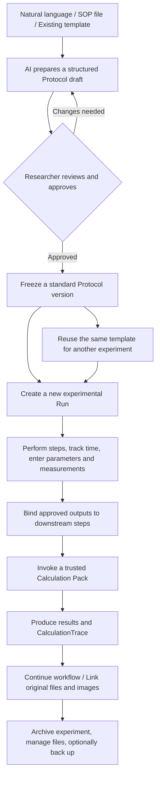

# Lab Workspace

### Turn a single sentence into a reusable laboratory protocol—and connect every step, measurement, and calculation

**Lab Workspace is a local-first, AI-assisted laboratory workspace for biomedical research.** It brings together **AI-assisted Protocol authoring, reusable standard workflows, step-by-step experiment execution and documentation, automatic parameter handoffs, trustworthy scientific calculations, raw-file management, and traceable results** in one application.

Instead of switching constantly between SOP documents, Excel sheets, timers, folders, and lab notebooks, you can follow one connected workflow: **describe an experiment → generate and review a Protocol → approve it as a versioned template → run it repeatedly → record data at each step → automatically feed results into downstream calculations → archive original files and the full evidence behind every result.**

**Target platforms:** Windows · Android · iOS | Flutter + Dart + SQLite | Single-user · Local-first · Optional AI and cloud services

[简体中文](./README.md) · [English](./README.en.md) · [Implementation status](./docs/implementation-status.md) · [Development documentation](./docs/00-scope-decisions.md) · [Build workflow](./.github/workflows/build-native-clients.yml)

> **Development status: V2.0 is under development; no fully runtime-validated production release is available yet.** The repository contains source code for native clients, domain and calculation foundations, Protocol/Run management, AI, imaging, file management, synchronization, and backup. Static-analysis results have been recorded, but end-to-end execution on supported platforms, notifications, cloud integrations, encrypted recovery, and cross-device conflict handling still require validation. The features below describe the intended product behavior and the scope represented in the codebase—not a claim that every feature has passed validation in real research settings. Maintain independent backups of important research data. See [Implementation status](./docs/implementation-status.md).

---

## Why Lab Workspace?

Common problems in laboratory research include:

- SOPs live in Word or PDF files and must be found, copied, and manually adapted for every experiment.
- The same experiment is repeated, but sample counts, treatment conditions, actual timing, and results are not managed consistently.
- A concentration calculated in one step must be copied into Excel to calculate a dilution or loading volume in the next.
- Spreadsheets retain final numbers but make it difficult to reconstruct formulas, units, original inputs, and calculation versions.
- Microscopy images, instrument exports, and analysis files are scattered across folders, making it hard to tell which sample each file belongs to.
- Changes to conditions, delayed steps, sample aliquoting, and experimental repeats often survive only as handwritten notes.

**Lab Workspace is not simply a digital replacement for paper laboratory records. Its goal is to turn experimental methods into reusable, data-connected workflows.**

## The 30-second overview: From Protocol to research result



Four concepts explain how the system works:

| Concept | In plain language | What it does |
| --- | --- | --- |
| **Protocol** | A standard experimental workflow template | Defines steps, required parameters, timers, measurement fields, calculation tools, and dependencies. Approved versions are fixed. |
| **Run (experiment execution)** | One actual instance of an experiment | One Protocol can create any number of Runs. Each Run independently records samples, actual conditions, timestamps, results, and revisions. |
| **Calculation Pack** | A reusable scientific calculation tool | Packages methods such as BCA fitting, dilution calculations, and Western Blot loading into validated, versioned calculation workflows. |
| **Skill** | Instructions that guide AI authoring and review | Helps draft Protocols, Calculation Packs, or image-operation plans. It does not bypass validation or automatically grant access to local resources. |

## A complete example: BCA protein assay → Western Blot

Suppose you need to extract protein from mouse tissue across several experimental groups, quantify it with a BCA assay, and perform a Western Blot (WB).

### 1. Create a Protocol in natural language

Simply describe what you want:

> Create a standard workflow covering BCA protein quantification through Western Blot. There are three experimental groups, with six samples per group. Every step should record its actual execution time and required parameters. The BCA step must retain standards, sample absorbance measurements, dilution factors, and QC results. Calculated protein concentrations should automatically feed into the subsequent WB loading-volume calculation. Require human confirmation at critical points and link the original WB images and analysis results when finished.

Within the capabilities already supported by the system, AI transforms this into an **editable, structurally validated, reviewable Protocol draft**, not merely an SOP essay. The draft may define:

- Samples, experimental groups, variables, and treatment conditions.
- Action, wait, measurement, calculation, image, and human-review steps.
- Required fields, data types, units, and valid ranges for each step.
- Dependencies between steps and explicit bindings from earlier outputs to later inputs.
- Optional timers, advance reminders, conditional branches, and repeated operations.
- Calculation Packs to invoke, together with pinned versions.
- SOP provenance, missing information, and issues requiring review.

**Important: AI-generated Protocols are drafts until approved.** Unknown reagent concentrations, temperatures, incubation times, and scientific procedures are not treated as established facts. A researcher must review the details before a draft becomes an approved template.

### 2. Review once, reuse many times

Save the reviewed workflow as `BCA → WB Protocol v1.0`. Future experiments no longer require rebuilding the procedure or calculation spreadsheets.

- Monday's experiment: create `Run #001` from v1.0.
- Wednesday's repeat: create `Run #002` from the same v1.0.
- Change the method later: create and review `v1.1` without overwriting completed Runs.

**A Protocol describes how an experiment should be performed; a Run records what actually happened.** Historical Runs retain their original Protocol version and parameter snapshot.

### 3. Follow the steps and record data as you work

Each step can have a purpose-built form generated from its Protocol definition, rather than a single free-text box.

| Step | Data recorded during this Run | Output / downstream use |
| --- | --- | --- |
| Sample preparation | Sample ID, group, source, treatment conditions | Associates the sample with later measurements, files, and calculations |
| BCA measurement | Standard concentrations, well positions, absorbance, sample dilution factors | Inputs to a standard-curve Calculation Pack |
| BCA calculation | Fitting method, QC approval | Protein concentration for each sample |
| WB loading preparation | Target protein mass, approved concentration | Automatically calculates sample volume and related preparation parameters |
| WB procedure | Actual start/end times, reagents, conditions, deviations | Preserves a complete execution record |
| Imaging and analysis | Original images, approved lanes/ROIs, background regions | Saves the analysis report and links it to the correct samples |

Steps may follow explicit dependencies or support parallel waits, decisions, bounded repetitions, and human review. An expired timer or delivered reminder does **not** automatically mark a physical experiment step as completed.

### 4. Automatically pass results from one step to the next

Suppose a sample has an approved BCA protein concentration of **2 µg/µL** and the WB target is **20 µg of protein per well**:

```text
Approved BCA result: Sample A protein concentration = 2 µg/µL
           ↓ Automatically bound to the WB loading step
Target protein mass = 20 µg
Stock sample volume = 20 µg ÷ 2 µg/µL = 10 µL
           ↓
Store the result, formula, units, input provenance, tool version,
and intermediate values
```

These are illustrative numbers, **not** a recommendation for any particular experimental setup. Real experiments must account for the relevant SOP, buffer composition, final volume, sample quality, and assay QC.

If an absorbance value was entered incorrectly, the system should preserve the original record and the reason for correction, produce a **new calculation version**, and flag affected downstream results for re-review—rather than silently rewriting a completed experiment.

### 5. Open any calculated result to inspect the evidence

A core requirement of Lab Workspace is **“Show raw calculation.”**

For every computed scientific value, you should be able to inspect the original inputs, associated samples, formulas, units, calculation nodes, full intermediate results, rounding rules, Pack/operator versions, quality checks, and underlying files—not just the final number.

**An AI explanation is not evidence that a calculation actually ran.** Values extracted or suggested by AI remain unverified suggestions until explicitly reviewed; they do not automatically become validated measurements.

### 6. Archive original images, analysis, and the experiment together

Import the original WB image as an immutable source asset. For image analysis, AI may propose regions of interest (ROIs), lanes, and background regions. A researcher reviews these selections before trusted tools perform deterministic measurements on the **unaltered original pixels**. Cropped or annotated images and analysis reports are saved as derived assets, never as replacements for the source image.

Ultimately, one Run can link its SOP version, samples and groups, step-by-step records, raw measurements, calculation traces, original images, derived results, and backup state.

---

## Core features

### ① Create Protocols with natural language—and approve them as standard workflows

Protocol creation is not limited to manual entry. The design supports five approaches:

1. **Describe an experiment in natural language:** Tell AI the experimental goal, samples, required measurements, and calculation dependencies.
2. **Import an existing SOP:** Organize steps from PDF, DOCX, Markdown, or images; explicit consent is required before using an external AI service.
3. **Reuse an approved template:** Select an existing Protocol version and start another experiment.
4. **Formalize a past experiment:** Turn an ad hoc Run into a new standard Protocol draft.
5. **Compose modules manually:** Adjust steps, variables, dependencies, timing, and tool references in the editor.

AI drafts must pass structural and parameter validation and receive human approval before they become approved versions. Publishing a new Protocol version does not change the evidence attached to historical Runs.

### ② Give every step its own inputs, measurements, outputs, and dependencies

A Protocol is more than a checklist. Each step can define:

- **Inputs:** Numbers, units, choices, files, sample references, treatment conditions, and required-field rules.
- **Records:** Actual start/end times, operator confirmation, measurements, deviations, and attachments.
- **Outputs:** Measurements, calculations, images, or reports that can be bound to downstream steps.
- **Execution rules:** Prerequisites, parallel steps, waits, conditional branches, repetition limits, human review, and reminders.

Built-in step types include `action`, `wait`, `measure`, `calculate`, `image`, `record`, `decision`, `repeat`, `sample`, and `review`. Schema-driven forms reduce the need to build a custom screen for every experiment type.

### ③ Perform traceable calculations without copying values between spreadsheets

Approved Calculation Packs allow validated outputs from one step to become inputs for the next:

`Absorbance → Standard curve → Protein concentration → Dilution/loading volume → Normalized result`

Scientific calculations are designed to preserve a `CalculationTrace`: all inputs, dimensional checks, formulas, intermediate values, algorithm versions, QC results, execution environment, and outputs. The implementation provides inspection and relevant export paths for auditable calculation records. Changing parameters produces new results rather than silently overwriting history.

The repository includes **BCA standard-curve, WB loading-volume, and WB normalization** Packs, together with synthetic test inputs and expected outputs that illustrate the approach. Researchers must still validate the actual fitting method and QC thresholds for their own experiments.

### ④ Extend calculations with AI instead of rewriting the app for every method

Need a dilution calculator, replicate summary, or another standard-curve workflow? Describe the inputs, formulas, QC checks, and outputs in natural language. AI can assemble a **Calculation Pack draft** from the available trusted operators. The draft must pass Schema validation, unit checks, operator-availability checks, synthetic golden cases, and human review before installation.

- A new Pack can be reused across multiple Protocols and versioned independently.
- Declarative configurations can drive both forms and calculation flows without requiring a Flutter code change for every workflow.
- If a method requires an operator that does not exist, the system should report that limitation. **It must not execute arbitrary AI-generated Python as a trusted plugin.**
- The community Pack catalog is designed around signatures and hashes; this is not an unrestricted executable plugin marketplace.

### ⑤ Let AI understand images while keeping quantitative science reproducible

The app does not bundle large local image-recognition or segmentation models. With permission, a multimodal AI service can help interpret an image, suggest ROIs, or propose an annotation plan. After researcher approval, deterministic tools perform calculations using the original pixel data.

Four distinct use cases matter:

- **Image description:** Describe, organize, and annotate existing images.
- **Report extraction:** Suggest values from screenshots of instrument reports, followed by item-by-item human verification.
- **Scientific quantification:** Approve ROIs, channels, and background regions before calculating from original pixels and retaining a trace.
- **Presentation edits:** Produce separate crops, overlays, or edited images without presenting altered images as original quantitative evidence.

The current scientific-quantification code supports **unsigned 8-bit or 16-bit grayscale/RGB PNG/TIFF images in supported layouts**. JPEG, alpha-bearing images, and unsupported TIFF/pixel formats cannot be sent directly through that quantitative path. Imaging behavior and mobile execution still require real-world validation.

### ⑥ Manage actual raw research data with the built-in File Explorer

Files are not just paths in a database. Lab Workspace maintains references between files, experiments, steps, samples, and analyses.

- Browse, search, open files with the operating system, export, categorize, and inspect storage usage.
- Distinguish **original assets / derived assets / reports** and inspect provenance from source to result.
- Use content-addressed storage and deduplicate identical data to reduce wasted space.
- Support a recycle bin, deletion-impact previews, reference-aware cleanup, and storage optimization.
- When an original file must be removed, preserve references and missing-asset records so past results are not falsely represented as having accessible underlying evidence.
- Provide on-demand integrity verification and optional external references for very large assets, reducing unnecessary data movement.

**Integrity policy:** Every imported file receives a SHA-256 hash on initial import. Files at or below the configurable default threshold of **2 GiB** receive a full hash check on logical reads. Files above the threshold normally receive a lightweight metadata check, with full verification available on demand. **A quick metadata check is not equivalent to verifying content with SHA-256.**

### ⑦ Work locally without hosting a server; optionally sync and back up across devices

Basic use does not require Docker, a central server, a team account, or a permanent internet connection. Each device has its own SQLite database and managed file repository (Vault).

Optional integrations include:

- **OneDrive / S3-compatible object storage:** Exchange records and assets when needed, with configurable strategies for large-file transfer.
- **Independent backup and restore:** Store database snapshots and file-object archives separately; do not confuse “sync completed” with “recoverable backup.”
- **Optional remote encryption:** Choose plaintext or encrypted backups based on destination and file category. Recovery of encrypted data requires the key.
- **Credential isolation:** Keep API keys, tokens, and other secrets in platform secure storage—not in ordinary experiment records or Packs.

The application is not designed to sync a live SQLite database file directly. Cloud synchronization, conflict handling, encrypted recovery, and cross-device behavior still need validation in real environments.

### ⑧ Plan experiments, run parallel timers, send reminders, and integrate Microsoft To Do

Experiment steps can track estimated duration, actual start/end times, waiting states, advance reminders, and overdue alerts. Pending steps can be arranged along an experimental timeline based on dependencies, with a record of schedule changes.

Local tasks can optionally integrate with **Microsoft To Do** through separate OAuth authorization and user-confirmed task submission. The source also includes import and conflict-review paths that are disabled by default. **A reminder firing does not mean a step is complete; checking off a To Do item does not substitute for confirming experimental results.** Background mobile reminders, reminders after closing the Windows application, and real Microsoft-account interactions still require validation.

### ⑨ Extend laboratory capabilities with three AI Skills

| Skill | Purpose | Repository location |
| --- | --- | --- |
| **Protocol Author** | Turns natural language, SOPs, or previous experiments into versioned Protocol drafts | [`skills/lab-workspace-protocol-author`](./skills/lab-workspace-protocol-author/) |
| **Workflow Author** | Produces declarative Calculation Pack drafts from method descriptions and checks required operators and examples | [`skills/lab-workspace-workflow-author`](./skills/lab-workspace-workflow-author/) |
| **Image Orchestrator** | Coordinates image understanding, ROI approval, controlled tool execution, and protection of original images | [`skills/lab-workspace-image-orchestrator`](./skills/lab-workspace-image-orchestrator/) |

Configurable AI providers include OpenAI Responses, Chat Completions, and compatible services. Available features depend on whether a selected model supports structured output, vision, and tool calling. **Cloud AI calls require explicit authorization; when offline or without a compatible model, local documentation and supported deterministic calculations remain available.**

---

## Where can you use it?

| Research scenario | How you would use Lab Workspace | Benefit |
| --- | --- | --- |
| **BCA / Western Blot** | Chain standard-curve and loading-volume calculations; record each step; link original images and quantitative evidence | Less copy-pasting, fewer unit errors, and traceable results |
| **Immunofluorescence / tissue staining** | Reuse a staining Protocol; record reagents, incubation conditions, samples, and images | Clearer batch documentation and images linked to their experiments |
| **Animal experiments / time-point sampling** | Track animal and sample IDs, groups, treatments, actual timestamps, and subsequent aliquots | Better sample provenance and multi-time-point scheduling |
| **Cell experiments / concentration series** | Standardize treatment steps; record actual concentrations, exposure times, and measurements; reuse dilution calculations | Less repetitive setup and more reproducible conditions |
| **Developing and refining SOPs** | Draft a workflow with natural language, approve v1.0, and issue v1.1 when methods change | Turn practical experience into standardized methods |
| **Instrument data / research-image archives** | Retrieve originals, derivatives, and calculations by experiment or sample; inspect dependencies before deleting | Faster retrieval and lower risk of breaking provenance |
| **Research across devices** | Organize experiments and files on a desktop, check tasks and steps on a phone, and sync selectively | Continue work across devices without requiring large uploads |

These are **intended product scenarios**, not a claim that each experiment type already has a preinstalled, validated Protocol. The most inspectable examples currently in the repository concern BCA/WB and the generic workflow engine.

## Guardrails for trustworthy research

Lab Workspace aims to reduce repetitive work with AI—not to delegate scientific judgment to a model.

| The system can assist with | What it must not do by default |
| --- | --- |
| Draft workflows from descriptions and SOPs | Invent critical experimental conditions and approve them automatically |
| Calculate from approved formulas and inputs | Treat numbers in an AI-generated explanation as a real calculation trace |
| Propose image lanes and ROIs | Use generatively modified images as original quantitative evidence without review |
| Install validated, declarative Calculation Packs | Execute arbitrary code generated on the fly by a model |
| Flag data conflicts and file risks | Silently overwrite previous results, original assets, or historical Protocols |
| Connect to cloud models and services with consent | Upload an entire workspace or expose API keys without authorization |

This is research-support software. **It does not guarantee experimental methods, statistical inferences, or scientific conclusions, and it has no claimed clinical or regulatory certification.**

## Current implementation status

| Capability | What the repository contains | What still needs validation |
| --- | --- | --- |
| Native app and local core | Flutter app, shared Dart core, SQLite migrations, and UI source | Complete user workflows and runtime stability across platforms |
| Protocol / Run / samples | Domain models, execution and versioning contracts, and related services | Real user workflows, step handoffs, and end-to-end execution |
| Calculation Packs / traces | Built-in BCA/WB examples, primitives, approval, and tracing code | Scientific-method validation, platform consistency, and more real-world datasets |
| AI / Skills / imaging | Provider integration, draft approval, image ROI and tracing code | Live service connectivity, real images, and platform-specific execution |
| File Explorer / integrity | Import, references, integrity checks, deletion, and storage-management code | Large files, interruption recovery, and destructive-action scenarios |
| Sync / backup / encryption | OneDrive/S3, snapshots, and recovery-related code | Live accounts, cross-device conflicts, independent restores, and security review |
| Scheduling / notifications / To Do | Local tasks, native notification bridge, and Microsoft Graph integration code | Background notifications and real Microsoft-account verification |

The table reflects the repository's [V2.0 implementation status](./docs/implementation-status.md). **Passing static analysis is not the same as passing functional tests, real-device tests, or biomedical research validation.**

## Getting started

For now, developers should build from source and try the app with **synthetic or non-sensitive test data**. Do not use it as the sole repository for important research records.

### Development environment

| Platform | Basic requirements |
| --- | --- |
| General | Flutter (CI uses 3.47.7) and a matching Dart SDK |
| Windows | Windows host and Visual Studio C++ desktop build tools |
| Android | Android SDK, Java 17, and matching Android build tools |
| iOS | macOS, Xcode, and iOS toolchain; signed distribution also requires Apple developer configuration |
| Reference validation | Python and `jsonschema` for contract/example validation |

### Run the Windows development client

From the repository root:

```bash
git clone https://github.com/jung233/Lab_Workspace.git
cd Lab_Workspace/apps/lab_workspace
flutter doctor
flutter pub get --enforce-lockfile
flutter analyze --no-pub
flutter run -d windows
```

For Android, confirm the target using `flutter devices` and then run `flutter run -d <device-id>`. For iOS, first run `bash tooling/release/prepare_ios_python.sh` from the repository root to prepare and verify the pinned Python runtime, then proceed with the client build.

These are **development commands—not a promise of a tested one-click installation**.

### Native builds and CI artifacts

The repository includes a [Build native clients](./.github/workflows/build-native-clients.yml) GitHub Actions workflow defining build paths for Windows x64, an Android debug APK, and unsigned iOS Simulator artifacts. Downloadable artifacts are produced only after the relevant jobs succeed. The presence of a workflow file does not mean those builds have succeeded or are production-ready. An iOS Simulator build is not an installable IPA for physical devices.

### Repository layout

```text
Lab_Workspace/
├── apps/lab_workspace/          # Native Flutter client (Windows / Android / iOS)
├── packages/lab_core/           # Shared Dart core: experiments, Protocols, calculations, data
├── built_in_packs/              # BCA, WB loading, and normalization examples
├── skills/                      # Protocol / Workflow / Image AI Skills
├── contracts/                   # Versioned JSON Schemas and interface contracts
├── python/                      # Trusted Python calculations and AI SDK bridge
├── db/                          # Reference SQLite DDL and extensions
├── examples/                    # Synthetic inputs, Protocols, and workflow examples
├── docs/                        # System design, specifications, and implementation status
├── tests/                       # Reference tests
├── tooling/                     # Contract validation, static tooling, release scripts
├── .github/workflows/           # Native client builds
├── README.md                    # Chinese overview
└── README.en.md                 # English overview
```

The source repository is **not** your experiment Vault. Runtime data belongs in the operating system's application-data directory. **Do not synchronize a live Vault directory as though it were an ordinary cloud-drive folder.**

## Developer documentation and extensions

- [Scope, decisions, and non-goals](./docs/00-scope-decisions.md)
- [Architecture and directory structure](./docs/01-architecture-and-directory.md)
- [Protocols, Runs, samples, and timing](./docs/02-domain-and-protocol.md)
- [Calculation Packs, dynamic forms, and AI Skills](./docs/03-workflow-packs-and-skills.md)
- [File Explorer, SHA-256, and storage cleanup](./docs/04-asset-explorer-integrity.md)
- [Synchronization, backups, and optional encryption](./docs/05-sync-backup-optional-encryption.md)
- [Calculation transparency, AI, Python, and imaging tools](./docs/06-python-ai-image-trace.md)
- [Security, tests, and release requirements](./docs/07-security-release-tests.md)
- [Internal APIs and interaction contracts](./docs/08-implementation-contracts.md)
- [Technical references and platform constraints](./docs/09-verified-technology-references.md)
- [Signed community declarative Pack catalog](./docs/community-pack-catalog-v1.md)
- [Implementation status and pending validation](./docs/implementation-status.md)
- [AI coding-agent development guidelines](./AGENTS.md)

To extend the set of supported experiments, start with **Protocols / Calculation Packs / Skills** instead of building a custom interface for every method. New calculation operators and native platform dependencies still require dedicated development, testing, versioning, and user approval.

## Frequently asked questions

**Do I need to deploy a server or Docker?**  No. Lab Workspace is intended as a single-user, local-first native application, not a web service or multi-user ELN. Cloud AI, OneDrive/S3, and Microsoft To Do are all optional integrations.

**Can a single sentence generate any experiment or scientific algorithm?**  No. AI helps structure workflows and assemble available calculation primitives. Critical conditions require review, and methods beyond existing primitives must still be implemented and validated.

**Do I have to configure an approved Protocol again every time?**  No. Create a new Run from an approved version whenever you repeat an experiment. Each Run has independent data, and changes to methods require a new Protocol version.

**Can a result from one step automatically feed into another?**  Yes, through explicitly defined output bindings and calculation-input references in the Protocol. Only data that meets the requirements and has been approved may feed trusted downstream calculations.

**Will AI image analysis modify my original images?**  Originals are preserved as immutable assets. Suggested regions require review, and scientific quantification is based on unmodified source pixels. Edits, annotations, and reports are stored separately as derived assets.

**Can I rely on Lab Workspace as the only copy of important data?**  Not yet. Real-platform behavior, backup recovery, and cross-device operation still require validation. Keep independent, tested backups of research data.

**Is Lab Workspace free and open-source software?**  The repository is publicly accessible, but no root-level `LICENSE` file was found at the time of this documentation. Public access alone does not grant permission to modify, redistribute, or commercially use the code. Refer to the repository's future official license statement.

---

**The goal of Lab Workspace is simple: make experimental methods reusable, connect data across every step, and make the evidence behind every result accessible.**
