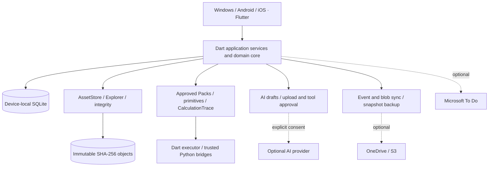

# Lab Workspace

### Connect experiment records, original data, and every calculation

**A single-user, local-first research workspace for biomedical experiments.** Connect projects, samples, Protocols, execution, scientific calculations, original files, and optional AI assistance into a traceable record.

[中文](README.md) · **English**

Windows · Android · iOS | Flutter + Dart + SQLite | V2.0 in development

> **Project status:** The repository contains a native client, shared core, Python bridges, data contracts, and reference examples, beyond the original specification kit. Source coverage is not functional acceptance: existing records include static analysis, while platform builds, device execution, cloud services, notifications, encrypted recovery, and cross-device behavior still need runtime verification. This README does not claim a fully accepted production release. See [implementation status](docs/implementation-status.md).

---

## Contents

- [Highlights](#highlights)
- [Features](#features)
- [Use cases](#use-cases)
- [Getting started and configuration](#getting-started-and-configuration)
- [Architecture and layout](#architecture-and-layout)
- [Development](#development)
- [Builds and distribution](#builds-and-distribution)
- [Documentation](#documentation)
- [Boundaries and FAQ](#boundaries-and-faq)

## Highlights

| Highlight | Research benefit | Principle |
| --- | --- | --- |
| **Local first, optional cloud** | Keep data on your devices; basic records and trusted local calculations do not depend on cloud services | Per-device SQLite + AssetStore; no mandatory central backend, web frontend, or Docker |
| **Executable SOPs** | Connect Protocol steps to samples, measurements, and timing records | Separate versioned Protocols from Runs; never overwrite approved versions |
| **Traceable results** | Follow results back to inputs, formulas, units, operator versions, and intermediate values | CalculationTrace and mandatory “展示原始计算” (Show original calculation); no silent historical rewrites |
| **Declarative extensions** | Combine existing operators instead of building a module for every experiment | Schema, primitive allowlist, golden cases, and approval; new primitives still need trusted development |
| **Reviewable AI assistance** | Receive workflow/ROI suggestions while controlling scientific choices and data transfer | Separate drafts, upload consent, tool approval, and execution; never automatically run model-generated Python |
| **Verifiable originals** | Reference one file across experiments and retain derived-output relationships | SHA-256 on ingest, immutable content-addressed storage, deletion impact analysis, reference-aware GC |
| **Separate sync and backup** | Exchange records across devices and retain independently restorable snapshots | Immutable event/blob sync, SQLite Online Backup, optional remote encryption |

## Features

These are modules present in source. Delivery readiness depends on [outstanding acceptance](docs/implementation-status.md#implementation-limits-and-acceptance-still-outstanding), especially for platforms and external services.

### Experiments, Protocols, and scheduling

- **Projects and experiments:** Manage groups, samples, and treatments; associate measurements, files, and calculations with experimental context.
- **Protocols and Runs:** Store structured workflows, versions, and approval state; execute independent Runs, record step states, and retain revisions.
- **Tasks and reminders:** Manage local tasks, timing records, and notifications. Permissions, background behavior, and devices require platform verification.
- **Overview:** Access experiments, files, calculations, AI, reminders, and integrations.

### Scientific calculations and Packs

The repository includes **BCA standard curve, WB loading volume, and WB normalization** Pack sources with synthetic inputs and expected outputs demonstrating the generic engine.

```text
Inputs and units → Approved Calculation Pack → Versioned allowlisted primitives
                → Results + CalculationTrace → Show original calculation
```

The engine supports decimal arithmetic, units, and versioned primitives, with a Dart executor and trusted Python bridges. Installation requires structural, supported-operation, golden-case, and approval checks. Community catalogs support pinned Ed25519 publisher keys, content hashes, and provenance for declarative Packs. A public marketplace and arbitrary executable plugin installation are not provided.

### File Explorer and integrity

- Hash originals with SHA-256 on ingest and retain immutable content-addressed objects; the database manages virtual folders and display names.
- Browse, system-open, inspect references, soft-delete, preview permanent deletion impact, analyze storage, and collect garbage.
- Multiple Assets may share an object; collection accounts for shared references, retained backups, remote tombstones, and active jobs.
- The **default strict-access threshold is configurable at 2 GiB**: smaller assets receive full SHA checks on logical reads; larger assets normally receive metadata quick checks, with full verification on request.

> **A quick check is not SHA verification.** Large assets are hashed on ingest, but subsequent metadata checks cannot prove every byte is unchanged.

### AI and images

Modules include separate Responses / Chat Completions adapters, an official OpenAI Python SDK bridge, provider capability probing, a bounded tool loop, versioned Skills, and Pack draft review.

Image workflows retain explicit review points:

1. Import and verify an immutable original; prepare a controlled preview.
2. Approve the provider, purpose, data scope, and upload contents before sending applicable data.
3. Review model-suggested pages, channels, ROIs, background regions, and methods.
4. Compute deterministically on approved original pixels; retain source hashes, integer sample hashes, intermediate values, and versioned traces.
5. Store crops, overlays, and exports as separate derived Assets linked to originals and reports.

Quantification accepts supported **unsigned 8/16-bit grayscale or RGB PNG/TIFF layouts**. Unsupported TIFF layouts, unsupported alpha-bearing data, and JPEG are rejected before upload; see [implementation status](docs/implementation-status.md) for details. There is no bundled local CV detector/segmenter. Generated or edited pixels cannot serve as quantitative scientific evidence.

### Sync, backup, and integrations

| Module | Source capabilities | Configuration and acceptance boundaries |
| --- | --- | --- |
| OneDrive / S3 | Immutable event/blob sync, selective transfer; S3 SigV4 and multipart upload | Configure destinations, credentials, and permissions; live provider/conflict acceptance remains pending |
| Independent backup | SQLite Online Backup snapshots, object archives, restore into a new directory | Sync success does not establish recovery; never sync a live SQLite file |
| Optional remote encryption | Plaintext/encrypted backups by destination and class; chunked AES-GCM | Independent plaintext recovery; encrypted recovery depends on keys and needs recovery/security acceptance |
| Microsoft To Do | OAuth, list discovery, confirmed push; default-off import, delta cursors, conflict review | Register a public client; live account verification remains pending |
| Local secret storage | Opaque SecretRef in SQLite, credentials in platform secure storage | No API keys in Packs, sync events, or backups |

Restore rotates local installation identity and authorization generation, preventing historical AI, ROI, or integration approvals from becoming authorization on a restored installation automatically.

## Use cases

### BCA → WB: concentration, loading, and images

Create an experiment and samples → select/review a Protocol → enter confirmed BCA data → run the standard curve Pack → inspect calculations → use confirmed results for WB loading volumes → import the WB original → review ROIs and quantify → link files, calculations, and reports → back up.

**Value:** Keep concentration, dilution, loading volume, and image results connected. Researchers must review fitting choices, background subtraction, and units. Repository examples are synthetic.

### Repeated experiments and SOP revisions

Approve a reusable workflow and create a separate Run for each experiment. New methods receive new versions while historical execution and calculation evidence remain intact. AI can help prepare Protocol or Calculation Pack drafts for review before use.

### Original data archives across devices

Import instrument files and images, inspect experiment references and storage in Explorer, optionally exchange events/objects through OneDrive/S3, and create separate recovery snapshots. Review deletion impact before removing assets referenced by other experiments.

### AI-assisted image review

Approve preview upload for supported original PNG/TIFF files, receive suggestions, confirm ROIs/channels, and run original-pixel statistics with retained traces. This supports reviewable workflows, not automatic scientific interpretation or arbitrary microscopy analysis.

## Getting started and configuration

The current entry point is **source development and verification**. A workflow definition does not establish that successful downloadable artifacts exist.

1. Prepare the toolchain below and start the client.
2. Startup creates a local Vault under the operating system application data directory, separating SQLite and managed objects.
3. Organize records in Experiments/Protocols and import originals through Files.
4. Review inputs, units, and approval in Calculations and Packs; inspect “展示原始计算” afterward.
5. For AI, configure the provider and runtime in provider settings and AI/image screens, then approve applicable transfers.
6. Configure cloud and To Do only when needed; validate sync, backup, and restore with nonsensitive fixtures before production use.

<details>
<summary><strong>Optional capability configuration</strong></summary>

| Capability | Requirements |
| --- | --- |
| Windows Python | Trusted Python/Conda/venv and project runner; SDK bridge additionally requires the official SDK. Never feed arbitrary AI code to the runner |
| Android / iOS Python | Packaged trusted runtime/native bridges; no promise of arbitrary native package installation at runtime |
| AI | Endpoint, model, API mode, securely stored credentials; provider capabilities are probed, and network probes may incur charges and require approval |
| OneDrive | Independent Files.ReadWrite OAuth configuration; do not assume To Do authorization applies |
| S3 | Compatible endpoint, bucket, secure credential reference |
| Microsoft To Do | Registered public client, tenant/client ID, delegated permissions, target list; confirm sync preview |
| Encrypted backups | Retain recovery keys and rehearse restore in a separate directory |

</details>

## Architecture and layout



**Current implementation:** Flutter native UI, shared pure-Dart core, versioned SQLite migrations, managed CAS, platform secret storage, and Python JSON-RPC/native bridges. Shared code is consolidated in `packages/lab_core/` and persistence directly uses `sqlite3`. Split packages and Drift in early designs are not the current implemented layout.

```text
LabWorkspace/
├── README.md / README.en.md          # Chinese / English landing pages
├── AGENTS.md                        # AI Coding Agent constraints
├── Lab_Workspace_V2.0_Complete_Development_Document.md
├── apps/lab_workspace/              # Native Flutter client
│   ├── lib/screens/                 # Experiments, files, calculations, settings
│   ├── lib/src/ai_image/            # AI, images, Pack review
│   ├── lib/integrations/            # Microsoft OAuth / To Do UI
│   ├── lib/platform/                # Secrets, files, notifications, calculations
│   ├── windows/                    # Windows runner
│   ├── android/                    # Native project and Python bridge
│   ├── ios/                        # Native project and Python bridge
│   └── pubspec.yaml / pubspec.lock  # Dependencies and pinned resolution
├── packages/lab_core/lib/src/       # Shared Dart core
│   ├── domain/                     # Entities, events, IDs, security, invariants
│   ├── application/                # Experiment, Protocol, Run, sample, task services
│   ├── persistence/                # SQLite and migrations
│   ├── assets/                     # CAS, references, integrity, deletion
│   ├── calculation/                # Engine, primitives, units, traces
│   ├── packs/                      # Validation, registry, built-in catalog
│   ├── ai/                         # Adapters, Skills, drafts, review
│   ├── image/                      # Tools, ROIs, quantification traces
│   ├── sync/                       # Events, objects, cloud connectors
│   ├── backup/                     # Snapshots, encryption, recovery
│   └── integrations/               # Microsoft To Do services
├── python/                         # Trusted RPC, primitives, AI SDK bridge
├── built_in_packs/                 # BCA, WB loading volume, WB normalization
├── contracts/                      # Versioned JSON Schemas
├── db/                             # Reference SQLite DDL / extensions
├── examples/                       # Protocol, Pack, storage, image examples
├── skills/                         # Three independent author/orchestration Skills
├── tests/                          # Python reference contracts and fixtures
├── tooling/                        # Schema, manifest, static checks
│   └── release/                    # Native builds and iOS Python preparation
├── docs/                           # Specifications, status, catalog protocol
└── .github/workflows/              # Native client build definitions
```

**Repository and Vault differ:** Source lives in the repository; user data lives in the platform application-support Vault, logically containing databases, immutable objects, staging/caches, Packs, jobs, and backups. See [architecture](docs/01-architecture-and-directory.md) for the design; platform code determines actual paths. Do not sync a running Vault as an ordinary cloud-drive folder.

## Development

### Requirements

| Tool | Repository baseline |
| --- | --- |
| Flutter | CI pins **3.47.7**; app manifest requires `>=3.38.1` |
| Dart | `>=3.10.0 <4.0.0`, using a matching Flutter SDK |
| Windows | Windows host and Visual Studio C++ desktop toolchain |
| Android | Android SDK, Java 17; native project packages trusted Python |
| iOS | macOS, Xcode, iOS toolchain; signed distribution needs Apple provisioning |
| Python | Reference validation, tooling, trusted runners; contract checks need `jsonschema` |

Versions come from local manifests and CI, not validation of every combination. Ignored `.tooling/` is a local cache, not a dependency automatically supplied with a clone.

### Dependencies and startup

From the repository root, enter the client and preserve its lockfile:

```powershell
cd apps/lab_workspace
flutter doctor
flutter pub get --enforce-lockfile
flutter analyze --no-pub
flutter run -d windows
```

For Android, find a target with `flutter devices`, then use `flutter run -d <device-id>`. For iOS, first run `bash tooling/release/prepare_ios_python.sh` from the repository root on macOS, then resolve client dependencies and select a device. Preparation downloads and verifies a fixed CPython XCFramework.

### Static checks and reference validation

From the shared core package directory:

```powershell
cd packages/lab_core
dart pub get --enforce-lockfile
dart analyze lib
```

Run the following from the **repository root**. Installing `jsonschema` requires a dependency source; afterward, reference checks do not require cloud services:

```powershell
python -m pip install jsonschema
python tooling/validate_contracts.py
python tooling/manifest_tool.py
python -m unittest discover -s tests -v
python skills/lab-workspace-protocol-author/scripts/validate_protocol.py examples/protocol/bca-to-wb.json
python skills/lab-workspace-workflow-author/scripts/validate_workflow.py examples/bca/pipeline.json
python skills/lab-workspace-image-orchestrator/scripts/validate_image_job.py examples/storage/image-review-plan.json
```

These cover reference contracts and examples, not Flutter functionality, scientific method validation, devices, or cloud recovery. This README update did not launch the application or run these tests. Historical static checks are recorded in implementation status.

### Contribution and extension rules

1. **Read constraints:** Read [AGENTS.md](AGENTS.md) and `docs/00` through `docs/08` before changing domain/storage behavior.
2. **Prefer declarative extensions:** Compose versioned Packs from existing primitives. New operators/native dependencies need trusted development, review, and release; reject unsupported operations and arbitrary model code.
3. **Preserve compatibility:** Version schemas and provide migrations. Never modify approved Protocols or historical CalculationRuns in place.
4. **Retain evidence:** Trace derived scientific results and expose “Show original calculation.” Quantification requires reviewed ROIs and immutable originals.
5. **Preserve boundaries:** Obtain upload consent, inspect references before deletion, keep secrets in secure storage, and support plaintext/encrypted recovery.
6. **Record validation:** Check changes appropriately; run required unittests after reference-code refactoring. Keep tests offline, use synthetic BCA/WB fixtures, preserve lockfiles, and record pending acceptance.

### Three independent Skills

| Skill | Purpose |
| --- | --- |
| [Protocol Author](skills/lab-workspace-protocol-author/SKILL.md) | Natural language/SOP → Protocol draft |
| [Workflow Author](skills/lab-workspace-workflow-author/SKILL.md) | Declarative Calculation Packs and supported-operator checks |
| [Image Orchestrator](skills/lab-workspace-image-orchestrator/SKILL.md) | Image suggestions, upload consent, ROI review, trusted tools |

Install each directory as a separate Skill; Skills do not bypass application approvals or primitive restrictions.

## Builds and distribution

[Build native clients](.github/workflows/build-native-clients.yml) runs on pushes to `main` / `master` or manual dispatch. Successful platform jobs upload separate Actions artifacts retained for 14 days:

| Artifact | Contents | Intended use |
| --- | --- | --- |
| `Lab-Workspace-Windows-x64-unsigned` | Complete EXE and required Flutter/plugin DLL directory ZIP | Unsigned development output, not MSIX; retain the whole directory |
| `Lab-Workspace-Android-debug-APK` | Debug APK with trusted Python | Development build, not store release |
| `Lab-Workspace-iOS-simulator-unsigned` | Simulator `Runner.app` ZIP | Not an installable device IPA |

Equivalent local commands are `flutter build windows --release`, `flutter build apk --debug --target-platform android-arm64,android-x64`, and `flutter build ios --simulator --no-codesign`, from the client directory on the appropriate host. Prepare Python first for iOS. See [release tooling](tooling/release/README.md) and its scripts. A workflow definition alone is not successful-build evidence.

## Documentation

Detailed engineering documents are mostly in Chinese; this README provides the English project overview and development entry point.

| Document | Contents |
| --- | --- |
| [Complete development document](Lab_Workspace_V2.0_Complete_Development_Document.md) | Combined engineering specification and handoff |
| [00 · Scope](docs/00-scope-decisions.md) | Scope, non-goals, frozen decisions |
| [01 · Architecture](docs/01-architecture-and-directory.md) | Native architecture, planned modules, Vault |
| [02 · Domain and Protocols](docs/02-domain-and-protocol.md) | Entities, state machines, execution, timing |
| [03 · Packs and Skills](docs/03-workflow-packs-and-skills.md) | Declarative workflows, primitives, extensions |
| [04 · Files and integrity](docs/04-asset-explorer-integrity.md) | SHA, references, deletion, GC |
| [05 · Sync and backup](docs/05-sync-backup-optional-encryption.md) | Events, snapshots, encryption, recovery |
| [06 · Python, AI, traces](docs/06-python-ai-image-trace.md) | Trusted execution, tools, original calculations |
| [07 · Security and release](docs/07-security-release-tests.md) | Privacy, safety, milestones, acceptance |
| [08 · Contracts](docs/08-implementation-contracts.md) | Interfaces, errors, settings, interactions |
| [09 · Technical references](docs/09-verified-technology-references.md) | Official references and device boundaries |
| [Implementation status](docs/implementation-status.md) | Source evidence, historical checks, runtime gaps |
| [Community catalog protocol](docs/community-pack-catalog-v1.md) | Signing, publisher trust, distribution |

Early specifications retain the target architecture and historical baseline. Read them alongside source/status; planned directories are not an inventory of actual files.

## Boundaries and FAQ

<details>
<summary><strong>Do I need internet, an account, or a server?</strong></summary>

The basic workspace is single-user and local-first, without a mandatory central backend, team account system, or Docker. AI, OneDrive/S3, and To Do are optional network integrations requiring their own configuration/authorization. Targets are Windows, Android, and iOS, not Web/PWA.

</details>

<details>
<summary><strong>Can every experiment be added without code?</strong></summary>

Existing primitives can express new workflows through Packs. Unknown operations, new scientific algorithms, and native dependencies still need trusted implementation/validation. Model-provided numbers or explanations are not verified exact scientific calculations.

</details>

<details>
<summary><strong>Are sync and backups verified in real environments?</strong></summary>

Services and restore authorization isolation exist in source. Cloud services, encrypted recovery, cross-device conflicts, mobile Python, and notifications still need runtime verification. Complete relevant platform and independent recovery acceptance before production research use.

</details>

<details>
<summary><strong>Are scientific correctness, clinical compliance, and open-source licensing guaranteed?</strong></summary>

The platform records, executes, and traces evidence; it does not automatically validate methods, fitting models, acquisition conditions, or conclusions, nor establish clinical/regulatory certification. AI transfers must follow institutional policy. There is currently no root LICENSE; do not assume an open-source redistribution license has been granted.

</details>
