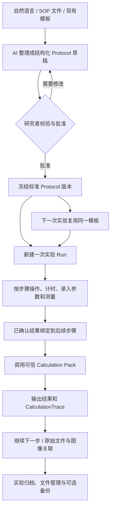

# Lab Workspace

### 从一句话创建标准实验流程，让每一步操作、数据和计算都能衔接起来

**Lab Workspace 是面向生物医学科研的本地优先智能实验工作台。** 它将 **AI 辅助创建 Protocol、标准流程复用、逐步执行与记录、参数自动传递、可信科研计算、原始文件管理和可追溯结果** 放在同一个应用中。

不必在 SOP、Excel、倒计时工具、文件夹和实验记录本之间来回切换：**描述一次实验 → 生成并审核 Protocol → 固定为标准模板 → 多次执行 → 逐步录入数据 → 自动衔接下一步计算 → 归档原件及全部计算依据。**

**平台目标：** Windows · Android · iOS ｜ Flutter + Dart + SQLite ｜ 单用户 · 本地优先 · AI 与云端可选

[中文](./README.md) · [English](./README.en.md) · [实现状态](./docs/implementation-status.md) · [开发文档](./docs/00-scope-decisions.md) · [构建工作流](./.github/workflows/build-native-clients.yml)

> **开发状态：V2.0 研发中，尚无经过完整运行验收的正式发行版。** 仓库已包含原生客户端、领域与计算核心、Protocol/Run、AI、图像、文件、同步及备份等源码；已有静态分析记录，但跨平台真机运行、通知、云服务、加密恢复和跨设备冲突等仍待验证。以下介绍产品工作方式与源码覆盖范围，不代表所有功能已在真实科研环境完成验收。正式科研数据请保留独立备份。参见 [实现状态](./docs/implementation-status.md)。

---

## 为什么需要 Lab Workspace？

实验中经常遇到这样的情况：

- SOP 保存在 Word 或 PDF 中，每次实验还要翻找、复制和手动修改。
- 同一个实验反复执行，但样本数、处理条件、实际耗时与实验结果没有统一管理。
- 前一步算出的浓度，下一步还要复制到 Excel 计算稀释倍数或上样体积。
- 计算表格只剩最终数值，很难回头核对公式、单位、原始输入和版本。
- 显微图片、仪器导出文件和分析结果散落在不同文件夹，不清楚对应哪个样本。
- 处理条件调整、计时延期、样本分装和重复实验，往往只能靠手写备注追踪。

**Lab Workspace 要做的不是把纸质实验记录改成电子表格，而是把实验方法变成可反复执行的数据流程。**

## 30 秒看懂：从 Protocol 到科研结果



四个概念是理解项目的关键：

| 概念 | 通俗理解 | 作用 |
| --- | --- | --- |
| **Protocol** | 标准实验流程模板 | 定义要做的步骤、所需参数、计时、测量字段、计算工具和步骤依赖；经审核后按版本固定。 |
| **Run（实验执行）** | 某一次真实实验 | 同一 Protocol 可以创建任意多次 Run，每次独立保存样本、实际条件、时间、结果与修订。 |
| **Calculation Pack** | 可复用的科研计算工具 | 将 BCA 拟合、稀释计算、WB 上样等方法组合为可校验、可版本化的计算流程。 |
| **Skill** | 告诉 AI 如何创建和审核内容的规则 | 辅助生成 Protocol、计算 Pack 或图像操作计划；不能跳过验证或直接获得本机权限。 |

## 一个完整的例子：BCA 蛋白定量 → Western Blot

假设要对不同实验组的小鼠组织进行蛋白提取、BCA 定量并完成 WB。

### 1. 用自然语言创建实验 Protocol

直接描述需求：

> 帮我建立一套 BCA 蛋白定量到 Western Blot 的标准实验流程。分为三个实验组，每组 6 个样本。每一步都要记录实际操作时间和必要参数；BCA 需要保存标准品和样本吸光度、稀释倍数及质控结果；计算出的蛋白浓度要自动用于后面的 WB 上样体积计算。需要人工确认关键操作，完成后关联 WB 原图和分析结果。

AI 在已有能力范围内，将需求整理为**可以编辑、校验和审核的 Protocol 草稿**，而不只是输出一篇 SOP 文章。草稿可包括：

- 样本及分组信息，实验变量与处理条件。
- 操作、等待、测量、计算、图像、人工审核等步骤。
- 每个步骤必须录入的字段、数据类型、单位和范围。
- 步骤之间的依赖关系，以及前一步输出到后一步输入的绑定。
- 可选的计时、提前提醒、条件分支和重复操作。
- 所调用的 Calculation Pack 及其固定版本。
- SOP 来源、需要补充的条件和可能存在的问题。

**重要：AI 生成的是待审核草稿。** 未知的试剂浓度、温度、孵育时长和科学方法不会自动当成事实；研究者检查后才能批准为正式模板。

### 2. 一次审核，以后直接复用

将确认过的流程保存为 `BCA → WB Protocol v1.0`，以后无需重复提问或重新搭建计算表。

- 周一开展实验：从 v1.0 创建 `Run #001`。
- 周三重复实验：仍用 v1.0 创建 `Run #002`。
- 后续更改某项方法：另存并审核 `v1.1`，不覆盖已经执行的 Run。

**Protocol 记录“标准应该怎么做”，Run 记录“这次实际做了什么”。** 历史 Run 始终引用执行时的流程版本和参数快照。

### 3. 按步骤执行，边做边记录

每一步都可以根据 Protocol 生成专用表单，而不是只有一个自由文本框。

| 步骤 | 本次需要记录 | 产生的结果 / 下一步用途 |
| --- | --- | --- |
| 样本准备 | 样本编号、实验组、来源、处理条件 | 将样本关联到后续测量、文件和计算 |
| BCA 测量 | 标准品浓度、孔位、吸光度、样本稀释倍数 | 输入标准曲线计算 Pack |
| BCA 计算 | 拟合方法、质控确认 | 输出各样本的蛋白浓度 |
| WB 上样准备 | 目标上样蛋白质量、已确认浓度 | 自动计算样本用量与相关配液参数 |
| WB 操作 | 实际开始/结束时间、试剂、条件、异常备注 | 保留完整操作记录 |
| 图像和分析 | 原始图像、泳道/ROI 审核、背景区域 | 保存分析报告并关联对应样本 |

步骤可以按依赖关系先后执行，也可定义并行等待、条件判断、有界重复和人工审核。通知到期不会自动把实际实验标记为完成。

### 4. 前一步结果自动传到下一步

例如，某个样本得到经审核的 BCA 蛋白浓度 **2 µg/µL**，WB 目标每孔上样 **20 µg**：

```text
BCA 已确认结果：样本 A 蛋白浓度 = 2 µg/µL
           ↓ 自动绑定到 WB 上样步骤
目标蛋白质量 = 20 µg
样本原液体积 = 20 µg ÷ 2 µg/µL = 10 µL
           ↓
保存计算结果、公式、单位、输入来源、工具版本和中间值
```

这里只是演示数据，不是针对具体实验条件的操作建议。实际还需按 SOP 处理缓冲液、终体积、样本质量及测量质控。

如果后来发现吸光度录入错误，系统应保留原记录和修订原因，生成**新的计算版本**，并提示相关下游结果重新审核，而不是无痕改写已完成的实验。

### 5. 每个计算结果都能点开查看依据

Lab Workspace 的核心约束是 **「展示原始计算」**。

对每个由计算产生的科研数值，都应能回到原始输入、实验样本、公式、单位、运算节点、完整中间结果、舍入规则、Pack/算子版本、质量检查及原始文件，而不只看到最终答案。

**AI 对数据的口头解释不是实际计算证据。** 未经确认的 AI 提取值只能是建议，不能自动变成已验证的测量结果。

### 6. 原图、分析结果和实验一起归档

将 WB 原图作为不可变原件导入文件库；需要图像分析时，可以由 AI 提议 ROI、泳道和背景位置，由研究者确认，再用可信工具在**未修改的原始像素**上进行确定性计算。裁剪图、标注图和报告另存为派生文件，不覆盖原图。

最后，一次 Run 可以关联：SOP 版本、样本与分组、逐步记录、原始测量、计算过程、原始图像、派生结果及备份状态。

---

## 核心特性

### ① 自然语言创建 Protocol，并固定成标准流程

创建 Protocol 不局限于手动输入，设计支持五种路径：

1. **自然语言描述**：告诉 AI 实验目标、样本、需要记录的参数和计算关系。
2. **导入已有 SOP**：从 PDF、DOCX、Markdown 或图片整理步骤；涉及外部 AI 时需要明确同意。
3. **复用标准模板**：直接选取已审核的 Protocol 版本开始新实验。
4. **从历史实验提炼**：把一次临时开展的实验整理成新的标准流程草稿。
5. **手动组合模块**：在编辑器中调整步骤、变量、依赖、计时和工具引用。

AI 草稿经过结构校验、参数检查和人工批准后，才可以作为标准版本使用。新增版本不改变已有实验的历史依据。

### ② 每一步都能有参数、测量、结果和上下游依赖

Protocol 不只是待办清单。每一步可以定义：

- **输入**：数值、单位、选项、文件、样本引用、处理条件和必填规则。
- **记录**：实际开始/结束时间、操作者确认、测量值、异常情况和附件。
- **输出**：测量数据、计算结果、图片或报告，能够绑定至后续步骤。
- **执行控制**：前置依赖、并行步骤、等待、条件分支、重复次数、人工审核与提醒。

内置步骤类型包括 `action`、`wait`、`measure`、`calculate`、`image`、`record`、`decision`、`repeat`、`sample` 和 `review`。根据 Schema 动态生成输入表单，减少为每种实验单独开发页面的工作。

### ③ 可追溯的自动计算，不再靠手工复制 Excel

通过已批准的 Calculation Pack，将上一步经过确认的数据自动提供给下一步，例如：

`吸光度 → 标准曲线 → 蛋白浓度 → 稀释/上样体积 → 归一化结果`

科研计算要求保留 `CalculationTrace`：完整输入、量纲检查、公式与中间结果、算法版本、质量控制、运行环境和输出。支持查看及按相应实现导出可审查的计算记录；修改参数时生成新结果，不悄悄覆盖历史。

仓库包含用于说明工作机制的 **BCA 标准曲线、WB 上样体积和 WB 归一化** Pack，以及合成测试输入与预期输出。实验的拟合方法和阈值仍需研究者自行验证。

### ④ 用 AI 扩展计算方法，无需为每个工具重写应用

想增加稀释计算、复孔统计或新的标准曲线流程，可以用自然语言描述输入、公式、质控和输出。AI 根据已有可信算子生成 **Calculation Pack 草稿**，经过 Schema、单位、支持算子、合成 golden case 及人工审核后再安装。

- 新 Pack 可以被多个 Protocol 复用，并独立版本化。
- 表单与计算流程可由声明式配置驱动，无需每次改 Flutter 源码。
- 现有算子无法实现的新算法，会明确提示能力缺失；**不会把 AI 临时生成的 Python 当作安全插件直接执行**。
- 社区 Pack 目录采用签名与哈希校验；目前不提供任意可执行插件市场。

### ⑤ AI 理解图像，科研定量交给可复核的工具

项目不在客户端捆绑大型自动识别/分割模型。多模态 AI 可以在授权后辅助理解图像、提议 ROI 或生成标注计划；研究者确认后，由确定性工具对原始像素计算。

区分四种不同用途：

- **图像说明**：描述、整理和标注已有图片。
- **报告提取**：从仪器报告截图建议提取数字，逐项人工核对。
- **科研定量**：确认 ROI、通道和背景后，在原始像素计算并保留 trace。
- **展示性编辑**：生成单独的裁剪、叠加或编辑图，不将修改图冒充定量原件。

当前科研定量源码仅面向受支持布局的 **8/16 位无符号整数 PNG/TIFF 灰度或 RGB**；JPEG、含 alpha 或其他不支持的 TIFF/像素布局不能直接走此定量路径。图像功能与移动端运行仍需实际验证。

### ⑥ 内置文件 Explorer，管理真正的原始科研数据

不仅保存“文件路径”，还建立文件与实验、步骤、样本和分析的引用关系。

- 浏览、搜索、系统打开、导出、分类和查看存储占用。
- 区分 **原始文件 / 派生文件 / 报告**，查看原件到结果的来源链。
- 内容寻址存储，相同内容可去重，避免大型文件重复占用。
- 支持回收站、删除影响预览、引用感知清理和空间优化。
- 对必须删除的原件，保留历史引用与缺失记录，避免误以为结果仍有可访问的原始证据。
- 为超大文件提供按需校验和可选外部引用方案，减少不必要的数据搬运。

**完整性规则：** 首次导入所有文件都计算 SHA-256；默认 **2 GiB**（可配置）及以下的文件在逻辑读取时完整核验，超过阈值的文件日常默认快速检查，必要时再全量核验。**文件属性快检不等于 SHA-256 内容验证。**

### ⑦ 本地优先、无需自建服务器，可选跨设备同步和独立备份

基础使用不依赖 Docker、中心服务器、团队账号或持续联网。每台设备有自己的 SQLite 数据库和受管文件库（Vault）。

可选能力包括：

- **OneDrive / S3 兼容对象存储**：按需交换记录与文件，可选择大文件传输策略。
- **独立备份与恢复**：数据库快照与文件对象归档，不把“同步成功”当成“备份可恢复”。
- **远端加密可选**：按目标和文件类别选用明文或加密备份；密文恢复需要密钥。
- **凭据隔离**：API Key、令牌及其他秘密保存于平台安全存储，不写入普通实验数据库和 Pack。

不会直接同步正在运行的 SQLite 数据库文件。云端同步、冲突处理、加密恢复和多设备行为尚待真实环境验收。

### ⑧ 实验日程、并行计时、提醒和 Microsoft To Do

实验步骤可以关联预计时长、实际开始与结束时间、等待状态、提前提醒和超时提示。支持把尚未完成的步骤按依赖关系安排到实验时间轴，并保留调整依据。

本地任务也可选对接 **Microsoft To Do**，使用独立 OAuth 授权和用户确认的任务推送；源码还包含默认关闭的导入与冲突审核路径。**提醒到期不等于实验完成，To Do 勾选也不会替代实验结果确认。** 手机后台提醒、Windows 退出后的提醒和真实 Microsoft 账户行为仍需验收。

### ⑨ 三种 AI Skill，让实验能力持续扩展

| Skill | 用途 | 仓库位置 |
| --- | --- | --- |
| **Protocol Author** | 从自然语言、SOP 或历史实验整理版本化 Protocol 草稿 | [`skills/lab-workspace-protocol-author`](./skills/lab-workspace-protocol-author/) |
| **Workflow Author** | 从方法描述生成声明式 Calculation Pack，检查所需算子与样例 | [`skills/lab-workspace-workflow-author`](./skills/lab-workspace-workflow-author/) |
| **Image Orchestrator** | 组织图像理解、ROI 审核、受控工具调用和原图保护 | [`skills/lab-workspace-image-orchestrator`](./skills/lab-workspace-image-orchestrator/) |

可配置支持 OpenAI Responses、Chat Completions 及相应兼容供应商，能力取决于具体模型是否支持结构化输出、视觉和工具调用。**调用云端 AI 前需要明确授权；离线或没有可用模型时，仍可使用本地记录与受支持的确定性计算。**

---

## 适合哪些科研场景？

| 应用场景 | 你可以怎样用 | 带来的价值 |
| --- | --- | --- |
| **BCA / Western Blot** | 从标准曲线到上样体积自动衔接；逐步记录、关联原图与定量依据 | 少复制数据、少算错单位，结果可追溯 |
| **免疫荧光 / 组织染色** | 复用染色 Protocol，记录试剂、孵育条件、样本与照片 | 批次条件有据可查，图片不再与实验脱节 |
| **动物实验 / 分时点取样** | 管理动物及样本编号、分组、处理、实际时间和后续分装 | 跟踪样本来源，梳理多时间点操作 |
| **细胞实验 / 浓度梯度** | 固定处理步骤，记录实际浓度、时长和测量值，复用稀释计算 | 减少重复设置，便于复现实验条件 |
| **新 SOP 建立与优化** | 自然语言生成草稿，批准为 v1.0，后续修订为 v1.1 | 将个人经验逐步沉淀为标准方法 |
| **仪器数据 / 科研图片归档** | 按实验和样本查找原件、衍生图、计算结果，删除前看关联 | 提高检索效率，避免无意破坏证据链 |
| **跨设备科研记录** | 电脑管理实验与文件，手机查看任务和步骤，按需同步 | 在不同设备延续工作，不强制上传大文件 |

这些是**产品目标场景**，不意味着上述每一种实验都已经预装并验收了专用 Protocol；当前仓库的可检查示例主要集中在 BCA/WB 及通用引擎。

## 为研究可信度设置的边界

Lab Workspace 尽量让 AI 帮你减少机械劳动，但不把科学判断交给模型自动决定。

| 系统可以辅助 | 不会默认替研究者做的事 |
| --- | --- |
| 从描述和 SOP 整理流程草稿 | 编造关键实验条件并直接批准 |
| 根据已批准的公式与输入计算 | 把 AI 文本里的数字冒充真实计算记录 |
| 建议图片中的泳道和 ROI | 未经确认就用生成式图片作为科研定量原件 |
| 安装通过验证的声明式计算 Pack | 自动执行模型临时生成的任意代码 |
| 发现数据冲突、提示文件风险 | 静默覆盖旧结果、原始文件或历史 Protocol |
| 在用户授权后访问云端模型和服务 | 未经同意上传整个工作区或暴露 API Key |

项目定位为科研工作辅助软件，**不保证实验方法、统计推断或科学结论正确，也不代表取得临床或监管认证**。

## 当前开发状态

| 能力领域 | 仓库现状 | 仍需验证 |
| --- | --- | --- |
| 原生客户端与本地核心 | Flutter 客户端、Dart 共享核心、SQLite 迁移及页面源码 | 各平台完整业务流程与运行稳定性 |
| Protocol / Run / 样本 | 领域模型、执行与版本契约、相关服务源码 | 真实用户操作、步骤联动与完整端到端验收 |
| Calculation Pack / trace | 内置 BCA/WB 示例、原语、审核及追踪源码 | 科学方法验证、平台一致性与更多真实数据 |
| AI / Skill / 图像 | Provider、草稿审核、图像 ROI 与追踪等源码 | 服务商联通、真实图片及各平台执行 |
| 文件 Explorer / 完整性 | 文件导入、引用、核验、删除及空间管理源码 | 大文件、异常中断和破坏性操作运行验收 |
| 同步 / 备份 / 加密 | OneDrive/S3、快照和恢复相关源码 | 真实账号、跨设备冲突、独立恢复及安全评估 |
| 日程 / 通知 / To Do | 本地任务、原生通知桥接、Microsoft Graph 集成源码 | 后台提醒与真实 Microsoft 账号验证 |

上述状态依据仓库的 [V2.0 实现状态记录](./docs/implementation-status.md)；**静态分析通过不等于功能测试、真实设备测试或医学科研验证通过**。

## 如何开始？

目前建议开发者从源码构建并使用**合成/非敏感测试数据**试用，勿将其作为唯一的科研数据仓库。

### 开发环境

| 平台 | 基础要求 |
| --- | --- |
| 通用 | Flutter（CI 使用 3.47.7）、匹配的 Dart SDK |
| Windows | Windows 主机、Visual Studio C++ 桌面工具链 |
| Android | Android SDK、Java 17、对应 Android 构建工具 |
| iOS | macOS、Xcode、iOS 工具链；签名发行还需 Apple 开发者配置 |
| 参考校验 | Python 与 `jsonschema`（用于契约/样例校验） |

### 启动 Windows 开发客户端

从仓库根目录执行：

```bash
git clone https://github.com/jung233/Lab_Workspace.git
cd Lab_Workspace/apps/lab_workspace
flutter doctor
flutter pub get --enforce-lockfile
flutter analyze --no-pub
flutter run -d windows
```

Android 可在 `flutter devices` 确认设备后用 `flutter run -d <device-id>`。iOS 需要先从仓库根目录运行 `bash tooling/release/prepare_ios_python.sh`，准备并校验固定的 Python 运行时，再进入客户端构建。

以上是**开发运行命令，不是经过验收的一键安装承诺**。

### 原生构建与 CI 产物

仓库提供 [Build native clients](./.github/workflows/build-native-clients.yml) GitHub Actions 工作流，定义了 Windows x64、Android debug APK、iOS 模拟器无签名产物的构建路径。只有对应任务成功后才会产生可下载 artifact；工作流文件的存在不代表这些产物已成功构建或可正式使用。iOS 模拟器包不能当作可在真机安装的 IPA。

### 核心目录

```text
Lab_Workspace/
├── apps/lab_workspace/          # Flutter 原生客户端（Windows / Android / iOS）
├── packages/lab_core/           # Dart 共享核心：实验、Protocol、计算、数据等
├── built_in_packs/              # BCA、WB 上样与归一化计算示例
├── skills/                      # Protocol / Workflow / Image 三种 AI Skill
├── contracts/                   # 版本化 JSON Schema 与接口契约
├── python/                      # 可信 Python 计算与 AI SDK 桥接
├── db/                          # SQLite 参考 DDL 与扩展
├── examples/                    # 合成输入、Protocol 和流程示例
├── docs/                        # 系统设计、规范与实现状态
├── tests/                       # 参考测试
├── tooling/                     # 契约验证、静态工具与发行脚本
├── .github/workflows/           # 原生客户端构建
├── README.md                    # 中文介绍
└── README.en.md                 # English
```

源码仓库不是你的实验 Vault：运行时数据保存在操作系统的应用数据目录。**不要把正在使用的 Vault 目录直接当成普通云盘文件夹进行同步。**

## 开发者文档与扩展

- [项目范围、决策和非目标](./docs/00-scope-decisions.md)
- [架构与目录](./docs/01-architecture-and-directory.md)
- [Protocol、Run、样本与时间管理](./docs/02-domain-and-protocol.md)
- [Calculation Pack、动态表单与 AI Skills](./docs/03-workflow-packs-and-skills.md)
- [文件 Explorer、SHA-256 与存储清理](./docs/04-asset-explorer-integrity.md)
- [同步、备份和可选加密](./docs/05-sync-backup-optional-encryption.md)
- [计算透明性、AI、Python 与图像工具](./docs/06-python-ai-image-trace.md)
- [安全、测试和发布要求](./docs/07-security-release-tests.md)
- [内部接口与交互契约](./docs/08-implementation-contracts.md)
- [技术参考与平台约束](./docs/09-verified-technology-references.md)
- [社区声明式 Pack 签名目录](./docs/community-pack-catalog-v1.md)
- [实现状态与待验收事项](./docs/implementation-status.md)
- [AI Coding Agent 开发约束](./AGENTS.md)

如需扩展实验方法，请优先考虑 **Protocol / Calculation Pack / Skill**，而不是为每种实验重复编写专属界面。新计算算子和平台原生依赖需要独立开发、测试、版本管理与用户批准。

## 常见问题

**是否需要部署服务器或 Docker？**  不需要。定位为单用户、本地优先的原生应用，不是 Web 服务或多人 ELN。云端 AI、OneDrive/S3、Microsoft To Do 均为按需配置的可选功能。

**一句话能生成任何实验和任意科学算法吗？**  不能。AI 能帮助组织流程和组合已支持的计算原语，关键条件必须审核；超出原语能力的新算法仍需实现和验证。

**已有 Protocol 每次还要重新配置吗？**  不需要。批准后的标准版本可以反复创建新的 Run。每一次执行的数据互相独立，修改方法时创建新版本。

**前一步数据能自动进入下一步吗？**  可以通过 Protocol 中预先定义的输出绑定和工具输入引用实现。只有符合要求、经过确认的数据才能用于后续可信计算。

**AI 分析图片时会改动原图吗？**  原始文件按不可变对象保存；建议区域须审核，科研量化以未修改的原始像素为依据。编辑、标注与报告另存为衍生文件。

**可以安心用它保存唯一一份重要数据吗？**  目前不建议。项目尚未完成真实平台、备份恢复和跨端验收；正式科研数据应另有独立且测试过的备份。

**这是自由开源软件吗？**  仓库公开可见，但当前未发现根级 `LICENSE` 文件；不能据此默认获得修改、再分发或商用的开源许可。授权以仓库后续正式许可声明为准。

---

**Lab Workspace 的目标很简单：让实验方法能复用，让每一步数据真正连起来，让每个结果都找得到依据。**
