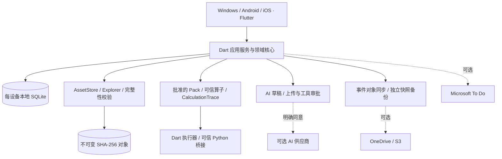

# Lab Workspace

### 让实验记录、原始数据与每一步计算相互关联

**面向生物医学实验的单用户、本地优先研究工作台。** 将项目、样本、Protocol、实验执行、科研计算、原始文件和可选 AI 辅助连接为可追溯的数据链。

**中文** · [English](README.en.md)

Windows · Android · iOS | Flutter + Dart + SQLite | V2.0 开发中

> **项目状态**：仓库已包含原生客户端、共享核心、Python 桥接、数据契约和参考示例，已超出最初的工程规格包阶段。源码覆盖不等于功能验收：现有记录包含静态分析结果，平台构建、真机执行、云服务、通知、加密恢复和跨设备行为仍需运行验证。本 README 不宣称已有经过完整验收的正式发行版。详见 [实现状态](docs/implementation-status.md)。

---

## 导航

- [项目特色](#项目特色)
- [功能说明](#功能说明)
- [使用场景](#使用场景)
- [上手与配置](#上手与配置)
- [架构与目录](#架构与目录)
- [开发指南](#开发指南)
- [构建与交付](#构建与交付)
- [文档索引](#文档索引)
- [边界与常见问题](#边界与常见问题)

## 项目特色

| 特色 | 对研究者的意义 | 实现原则 |
| --- | --- | --- |
| **本地优先，云端可选** | 数据保存在自己的设备上，基础记录与可信本地计算不依赖云服务 | 每设备独立 SQLite + AssetStore；无必选中心后端、Web 前端或 Docker |
| **从 SOP 到可执行流程** | Protocol 关联步骤、样本、测量和时间记录 | 版本化 Protocol 与执行 Run 分离；批准版本不原地改写 |
| **每个结果都能追溯** | 从结果回到输入、公式、单位、算子版本与中间步骤 | CalculationTrace + 必需的「展示原始计算」入口；历史结果不静默覆盖 |
| **用 Pack 扩展方法** | 用声明式配置组合既有算子，减少为每种实验重复开发 | Schema、原语白名单、golden 样例验证与批准；新算子仍需可信开发 |
| **AI 辅助可审核** | 模型建议流程与 ROI，研究者决定科学方法和数据外发 | 草稿、上传同意、工具批准与执行分离；不自动运行模型生成的 Python |
| **原始文件可核验** | 同一文件可被多个实验引用，保留原件与衍生结果的关系 | 导入 SHA-256、不可变内容寻址存储、删除影响分析与引用感知 GC |
| **同步与备份分离** | 多设备交换记录，同时保留可独立恢复的快照 | 同步不可变事件/对象；SQLite Online Backup 快照；远端加密可选 |

## 功能说明

以下为当前源码中的模块范围；平台和外部服务的交付状态须结合 [待验收事项](docs/implementation-status.md#implementation-limits-and-acceptance-still-outstanding) 判断。

### 实验、Protocol 与日程

- **项目与实验**：管理项目、实验、组别、样本及处理条件，将测量、文件和计算关联到实验上下文。
- **Protocol 与 Run**：保存结构化流程、版本和批准状态；通过独立运行实例执行步骤、记录状态并保留修订历史。
- **任务与提醒**：管理本机任务、时间记录与通知；通知权限、后台与真机行为仍需平台验证。
- **概览入口**：连接实验、文件、计算、AI、提醒和外部集成。

### 科研计算与 Pack

仓库提供 **BCA 标准曲线、WB 上样体积、WB 归一化** Pack 源文件，以及合成输入和预期输出，用于演示通用计算能力。

```text
输入与单位 → 已批准的 Calculation Pack → 版本化白名单算子
          → 计算结果 + CalculationTrace → 展示原始计算
```

引擎包含十进制数值、单位与版本化原语支持，提供 Dart 执行器及可信 Python 桥接。Pack 安装必须经过结构、支持算子、golden case 与批准校验。社区目录支持固定发布者 Ed25519 公钥、内容哈希与来源记录，分发声明式 Pack；不提供公共市场或任意可执行插件安装。

### 文件 Explorer 与完整性

- 导入时计算 SHA-256，以内容寻址方式保存不可变原件；数据库管理虚拟目录和显示文件名。
- 支持浏览、系统打开、引用关系、软删除、永久删除影响预览、存储统计与垃圾回收。
- 多个 Asset 可引用同一对象；回收考虑共享引用、备份保留、远端墓碑和活动任务。
- **默认严格访问阈值为 2 GiB，可配置**：较小文件在逻辑读取时完整 SHA 校验；较大文件默认元数据快检，按需完整复验。

> **快检不等于 SHA 校验。** 大文件导入时仍计算 SHA-256，但后续元数据快检不能证明全部字节未被修改。

### AI 与图像

AI 模块包含独立的 Responses / Chat Completions 适配器、官方 OpenAI Python SDK 桥接、供应商能力探测、受限工具循环、版本化 Skill 和 Pack 草稿审核。

图像流程保留明确审核点：

1. 导入不可变原图，核验内容并生成受控预览。
2. 批准供应商、用途、数据范围和上传内容后，模型才能接收相应数据。
3. 人工审查模型建议的页、通道、ROI、背景区域与方法。
4. 在批准的原始像素上执行确定性运算，保存输入哈希、整数样本哈希、中间值和版本化 trace。
5. 裁剪、叠加和导出生成独立衍生 Asset，保持原件与报告关联。

当前定量路径接受受支持布局的 **8/16 位无符号整数 PNG/TIFF 灰度或 RGB 图像**。不支持的 TIFF 布局、带 alpha 等不支持数据及 JPEG 会在上传前被拒绝；具体限制见 [实现状态](docs/implementation-status.md)。不包含本地自动 CV 检测/分割模型；生成或编辑后的像素不能作为科研定量证据。

### 同步、备份与集成

| 模块 | 源码能力 | 配置与验收边界 |
| --- | --- | --- |
| OneDrive / S3 | 不可变事件与对象同步、选择性传输；S3 SigV4 和分段上传 | 需配置目标、凭据与权限；真实服务和冲突验收待完成 |
| 独立备份 | SQLite Online Backup 快照、对象归档、恢复到新目录 | 同步成功不能替代恢复测试；不直接同步运行中的 SQLite 文件 |
| 可选远端加密 | 按目标和文件类别选择明文/加密备份，分块 AES-GCM | 明文独立恢复；密文依赖恢复密钥，仍需恢复与安全验收 |
| Microsoft To Do | OAuth、列表发现、确认后推送；默认关闭的导入、delta 游标与冲突审核 | 需自行注册公共客户端；真实账户验证待完成 |
| 本机安全存储 | SQLite 保存不透明 SecretRef，平台安全存储持有凭据 | 不把 API Key 放入 Pack、同步事件或备份 |

恢复流程包含本机安装身份与授权代次轮换，防止把旧设备的 AI、ROI 或服务批准直接当作新设备授权。

## 使用场景

### BCA → WB：从浓度到上样与图像记录

建立实验和样本 → 选择或审核 Protocol → 录入确认的 BCA 数据 → 运行标准曲线 Pack → 查看原始计算 → 将确认结果用于 WB 上样体积计算 → 导入 WB 原图 → 审查 ROI 后统计 → 关联文件、计算与报告 → 备份归档。

**价值**：让浓度、稀释倍数、上样体积和图像结果保持关联。拟合模型、背景扣除与单位必须由研究者审查；仓库示例为合成数据。

### 重复实验与 SOP 迭代

保存批准的流程版本，为每次实验建立独立 Run；修改方法时产生新版本，保留历史执行与计算依据。AI 辅助整理 Protocol 或 Calculation Pack 草稿，审查后再使用。

### 原始数据归档与多设备延续

导入仪器文件与图片，通过 Explorer 查找实验引用和存储占用；按需配置 OneDrive/S3 交换事件与对象，单独制作恢复快照。删除前检查影响，避免破坏其他实验仍引用的数据。

### AI 辅助图像审阅

对受支持的原始 PNG/TIFF，批准预览上传后获得模型建议，人工确认 ROI 与通道，再运行原像素统计并保存 trace。适合需要审核与计算证据的图像流程；不承诺自动完成科学判读或任意显微图像分析。

## 上手与配置

当前以**源码开发与验证**为主要入口；构建工作流的存在不代表已有可下载的成功产物。

1. 按开发指南准备工具链并启动客户端。
2. 应用启动时在操作系统应用数据目录创建本机 Vault，分别保存 SQLite 和受管对象。
3. 从「实验」「Protocols」组织记录，通过「文件」导入原始数据。
4. 在「计算与 Pack」审查输入、单位和批准状态，完成后查看「展示原始计算」。
5. 需要 AI 时，在「AI Provider 设置」「AI 与图像」配置供应商和运行环境，并确认适用的数据外发权限。
6. 按需配置云端与 To Do；正式使用前，用非敏感样例验证同步、备份和恢复。

<details>
<summary><strong>可选能力的配置要求</strong></summary>

| 能力 | 要求 |
| --- | --- |
| Windows Python | 配置可信 Python/Conda/venv 与项目 runner；AI SDK 桥接还需环境具备官方 SDK。不要向 runner 传入任意 AI 代码 |
| Android / iOS Python | 使用打包的可信运行时和原生桥接；不承诺运行时任意安装原生 Python 包 |
| AI | 设置端点、模型、API 模式和安全存储凭据；能力按供应商探测，联网探测可能产生费用并需批准 |
| OneDrive | 独立 Files.ReadWrite OAuth 配置，不复用 To Do 的授权假设 |
| S3 | 兼容端点、Bucket 与安全存储凭据引用 |
| Microsoft To Do | 注册公共客户端，配置 tenant/client ID、委托权限和列表；检查同步预览后确认 |
| 加密备份 | 妥善保存恢复密钥，在独立目录演练恢复 |

</details>

## 架构与目录



**当前实现**：Flutter 原生 UI、纯 Dart 共享核心、SQLite 版本化迁移、受管 CAS、平台安全存储和 Python JSON-RPC/原生桥接。共享核心集中在 `packages/lab_core/`，持久化直接使用 `sqlite3`；早期设计中的拆包目录和 Drift 方案不代表当前已落地结构。

```text
LabWorkspace/
├── README.md / README.en.md          # 中文主页 / 英文版
├── AGENTS.md                        # AI Coding Agent 约束
├── Lab_Workspace_V2.0_Complete_Development_Document.md
├── apps/lab_workspace/              # Flutter 原生客户端
│   ├── lib/screens/                 # 实验、文件、计算、提醒、设置页面
│   ├── lib/src/ai_image/            # AI、图像与 Pack 审核
│   ├── lib/integrations/            # Microsoft OAuth / To Do 界面
│   ├── lib/platform/                # 安全存储、文件、通知、计算适配
│   ├── windows/                    # Windows runner
│   ├── android/                    # Android 工程与 Python 桥接
│   ├── ios/                        # iOS 工程与 Python 桥接
│   └── pubspec.yaml / pubspec.lock  # 依赖及固定解析结果
├── packages/lab_core/lib/src/       # 共享 Dart 核心
│   ├── domain/                     # 实体、事件、ID、安全与不变量
│   ├── application/                # 实验、Protocol、Run、样本、任务服务
│   ├── persistence/                # SQLite 与迁移
│   ├── assets/                     # CAS、引用、完整性与删除
│   ├── calculation/                # 引擎、原语、单位与 trace
│   ├── packs/                      # Pack 检验、注册与内置目录
│   ├── ai/                         # AI 适配、Skill、草稿、审核
│   ├── image/                      # 图像工具、ROI 与定量追踪
│   ├── sync/                       # 事件/对象同步与云连接
│   ├── backup/                     # 快照、加密与恢复
│   └── integrations/               # Microsoft To Do 服务
├── python/                         # 可信计算 RPC、原语与 AI SDK 桥接
├── built_in_packs/                 # BCA、WB 上样体积、WB 归一化
├── contracts/                      # 版本化 JSON Schema
├── db/                             # SQLite 参考 DDL / 扩展
├── examples/                       # Protocol、Pack、存储与图像示例
├── skills/                         # 三个独立作者/编排 Skill
├── tests/                          # Python 参考契约与合成样例检查
├── tooling/                        # Schema、manifest、静态检查工具
│   └── release/                    # 原生构建与 iOS Python 准备脚本
├── docs/                           # 工程规范、实现状态、社区目录协议
└── .github/workflows/              # 原生客户端 CI 构建定义
```

**仓库与 Vault 不同**：仓库保存源码；用户数据位于应用支持目录的 Vault，逻辑上包括数据库、不可变对象、暂存/缓存、Pack、任务和备份等。设计示意见 [架构文档](docs/01-architecture-and-directory.md)，实际路径以平台实现为准。不要把运行中的 Vault 当普通云盘文件夹同步。

## 开发指南

### 环境要求

| 工具 | 仓库基线 |
| --- | --- |
| Flutter | CI 固定 **3.47.7**；应用 manifest 要求 `>=3.38.1` |
| Dart | `>=3.10.0 <4.0.0`，使用匹配的 Flutter SDK |
| Windows | Windows 主机与 Visual Studio C++ 桌面工具链 |
| Android | Android SDK、Java 17；原生工程打包可信 Python |
| iOS | macOS、Xcode 与 iOS 工具链；签名发行另需 Apple 配置 |
| Python | 参考校验、工具与可信 runner；契约校验依赖 `jsonschema` |

版本来自本地 manifest 和 CI，不表示已验证全部工具链组合。`.tooling/` 是被忽略的本机缓存，不是克隆仓库后自动具备的依赖。

### 安装依赖与启动

从仓库根目录进入客户端，保持提交的 lockfile：

```powershell
cd apps/lab_workspace
flutter doctor
flutter pub get --enforce-lockfile
flutter analyze --no-pub
flutter run -d windows
```

Android 用 `flutter devices` 查找目标，再执行 `flutter run -d <device-id>`。iOS 需在 macOS 上先从仓库根目录执行 `bash tooling/release/prepare_ios_python.sh`，再进入客户端解析依赖并选择设备。准备脚本会联网下载并校验固定的 CPython XCFramework。

### 静态检查与参考校验

在共享核心包目录检查：

```powershell
cd packages/lab_core
dart pub get --enforce-lockfile
dart analyze lib
```

以下从**仓库根目录**执行。安装 `jsonschema` 需要依赖源；安装完成后，参考校验无需访问云服务：

```powershell
python -m pip install jsonschema
python tooling/validate_contracts.py
python tooling/manifest_tool.py
python -m unittest discover -s tests -v
python skills/lab-workspace-protocol-author/scripts/validate_protocol.py examples/protocol/bca-to-wb.json
python skills/lab-workspace-workflow-author/scripts/validate_workflow.py examples/bca/pipeline.json
python skills/lab-workspace-image-orchestrator/scripts/validate_image_job.py examples/storage/image-review-plan.json
```

这些检查覆盖参考契约与示例，不能替代 Flutter 功能测试、科学方法验证、真机测试和云端恢复验收。本次 README 更新未启动应用或执行上述测试；既有静态检查见实现状态记录。

### 修改与扩展约定

1. **先读约束**：阅读 [AGENTS.md](AGENTS.md) 和 `docs/00` 至 `docs/08`，再修改领域或存储行为。
2. **优先配置扩展**：用现有原语组合版本化 Pack。新算子或原生依赖需可信开发、审核与发布；拒绝不支持操作，不执行任意模型代码。
3. **维护兼容**：Schema 与数据库变更提供新版本和迁移；不原地修改批准的 Protocol 或既往 CalculationRun。
4. **保留证据**：科学派生结果保存 trace 并提供「展示原始计算」；图像定量限于已审核 ROI 和不可变原件。
5. **守住数据边界**：上传需同意，删除先分析引用，凭据放安全存储；明文与加密恢复均应可用。
6. **提交验证记录**：按改动范围检查；重构参考代码后运行规定的 unittest。测试不联网、BCA/WB 用合成 fixtures，固定 lockfile 并记录未验收项。

### 三个独立 Skill

| Skill | 用途 |
| --- | --- |
| [Protocol Author](skills/lab-workspace-protocol-author/SKILL.md) | 自然语言/SOP → Protocol 草稿 |
| [Workflow Author](skills/lab-workspace-workflow-author/SKILL.md) | 声明式 Calculation Pack 与支持算子检查 |
| [Image Orchestrator](skills/lab-workspace-image-orchestrator/SKILL.md) | 图像建议、上传同意、ROI 审核与可信工具编排 |

每个目录是一份独立 Skill，应分别安装；它们不能绕过应用批准或原语限制。

## 构建与交付

[Build native clients](.github/workflows/build-native-clients.yml) 在推送 `main` / `master` 或手动触发时构建。成功的平台任务分别上传保留 14 天的 Actions artifact：

| 产物 | 内容 | 定位 |
| --- | --- | --- |
| `Lab-Workspace-Windows-x64-unsigned` | EXE 与必要 Flutter/plugin DLL 的完整目录 ZIP | 未签名开发产物，非 MSIX；需保留完整目录 |
| `Lab-Workspace-Android-debug-APK` | 含可信 Python 的 debug APK | 开发构建，非商店发行包 |
| `Lab-Workspace-iOS-simulator-unsigned` | 模拟器 `Runner.app` ZIP | 不能作为真机 IPA 安装 |

对应本地命令为 `flutter build windows --release`、`flutter build apk --debug --target-platform android-arm64,android-x64`、`flutter build ios --simulator --no-codesign`，在客户端目录及对应主机执行；iOS 先准备 Python 运行时。详见 [release 工具](tooling/release/README.md) 与相关脚本。工作流定义本身不是构建成功证据。

## 文档索引

| 文档 | 内容 |
| --- | --- |
| [完整开发文档](Lab_Workspace_V2.0_Complete_Development_Document.md) | 合并工程规范与研发交接入口 |
| [00 · 范围决策](docs/00-scope-decisions.md) | 范围、非目标、冻结决策 |
| [01 · 架构与目录](docs/01-architecture-and-directory.md) | 原生架构、规划模块、Vault |
| [02 · 领域与 Protocol](docs/02-domain-and-protocol.md) | 实体、状态机、执行、计时 |
| [03 · Pack 与 Skill](docs/03-workflow-packs-and-skills.md) | 声明式工作流、原语、扩展 |
| [04 · 文件与完整性](docs/04-asset-explorer-integrity.md) | SHA、引用、删除、GC |
| [05 · 同步与备份](docs/05-sync-backup-optional-encryption.md) | 事件、快照、加密、恢复 |
| [06 · Python、AI 与 trace](docs/06-python-ai-image-trace.md) | 可信执行、图像工具、原始计算 |
| [07 · 安全与发布](docs/07-security-release-tests.md) | 隐私、安全、里程碑、验收 |
| [08 · 实施契约](docs/08-implementation-contracts.md) | 接口、错误码、设置、交互 |
| [09 · 技术参考](docs/09-verified-technology-references.md) | 官方参考与真机边界 |
| [实现状态](docs/implementation-status.md) | 源码证据、历史检查、运行验收缺口 |
| [社区 Pack 目录协议](docs/community-pack-catalog-v1.md) | 签名、发布者信任、内容分发 |

早期规范保留目标架构和历史基线。了解当前实现时，应结合源码与实现状态，不能把规划目录当实际清单。

## 边界与常见问题

<details>
<summary><strong>必须联网、注册账户或部署服务器吗？</strong></summary>

基础工作区按单用户、本地优先设计，无必选中心后端、团队账户体系或 Docker。AI、OneDrive/S3 和 To Do 为可选联网集成，各自需要配置与授权。正式目标为 Windows、Android、iOS，不包含 Web/PWA。

</details>

<details>
<summary><strong>任何新实验都不用改代码吗？</strong></summary>

现有原语能表达的流程可通过 Pack 扩展。未知操作、新科学算法或原生依赖仍需可信实现与验证。模型给出的数字或解释不能直接作为已验证的精确科学计算。

</details>

<details>
<summary><strong>同步和备份已通过真实环境验证吗？</strong></summary>

源码包含相关服务和恢复授权隔离，但实现状态仍将云服务、加密恢复、跨设备冲突、移动 Python 和通知列为需运行验证的事项。正式研究使用前应完成对应平台和独立恢复验收。

</details>

<details>
<summary><strong>是否保证科学结论、临床合规和开源授权？</strong></summary>

平台提供记录、执行和证据追踪，不自动保证方案、拟合模型、采集条件或结论正确，也不构成临床或监管认证。AI 外发数据须符合机构政策。仓库当前无根级 LICENSE，不应默认存在开源再分发授权。

</details>
