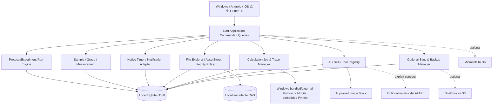

# 01｜系统架构、模块边界与完整目录约定

## 1.1 一套原生客户端，共享核心代码



**一项跨端计算工具**绑定 `CalculationEngine` 接口：同样的公式/步骤/计算追踪在所有端复用；Windows 可使用单独 Python 子进程，Android/iOS 用应用内嵌 CPython Bridge。APP 不允许 Python 插件直接更新 SQLite 或任意文件。

## 1.2 明确的 Monorepo 目录树

```text
lab-workspace/                            # Git 仓库根目录
├── README.md
├── LICENSE
├── CHANGELOG.md
├── pubspec.yaml                            # Flutter workspace
├── pubspec.lock
├── analysis_options.yaml
├── apps/
│   └── lab_workspace/                      # 原生 Flutter 应用
│       ├── lib/
│       │   ├── main.dart
│       │   ├── bootstrap/
│       │   ├── routes/
│       │   ├── screens/
│       │   │   ├── dashboard/
│       │   │   ├── experiment_run/
│       │   │   ├── protocol_editor/
│       │   │   ├── samples/
│       │   │   ├── schedule/
│       │   │   ├── raw_file_explorer/      # 新增：资产浏览/删除/恢复
│       │   │   ├── ai_assistant/
│       │   │   ├── calculation_trace/
│       │   │   ├── sync_and_backup/
│       │   │   └── settings/
│       │   └── widgets/
│       │       ├── calculation_trace_button/
│       │       ├── asset_lineage_panel/
│       │       ├── user_approval_sheet/
│       │       └── countdown_tile/
│       ├── windows/                         # Windows Native Runner + installer
│       ├── android/                         # Kotlin bridge + Python runtime
│       ├── ios/                             # Swift bridge + Python framework
│       ├── test/
│       └── integration_test/
├── packages/
│   ├── domain/                             # 值对象/事件/不变量/状态机
│   ├── application/                        # command/query/transaction coordinator
│   ├── persistence/                        # Drift ORM / SQLite migrations
│   ├── protocol_engine/                    # Protocol DSL / DAG / 执行实例
│   ├── workflow_runtime/                   # 通用工作流原语与执行解释器
│   ├── pack_registry/                      # Pack 发现/检查/安装/签名/卸载
│   ├── scientific_units/                   # 单位、维度与十进制数值
│   ├── calculation_engine/                 # Python Executor + CalculationTrace
│   ├── ai_provider/                        # Responses/Chat Completions adapter
│   ├── skill_registry/                     # Skill元数据/提示词/工具能力绑定
│   ├── image_tool_registry/                # 无本地CV模型的受控图像工具
│   ├── file_explorer/                      # 目录视图/引用/删除/垃圾箱
│   ├── asset_store/                        # CAS / SHA Policy / 大文件读取
│   ├── scheduler/                          # 计划/实际时间/本地系统提醒
│   ├── sync_engine/                        # 事件合并/选择性对象缓存
│   ├── cloud_connectors/                   # OneDrive/S3/手动导出
│   ├── backup_engine/                      # 快照/可选加密/恢复
│   └── microsoft_todo/                     # Graph任务映射/重试
├── python/
│   ├── runner/                             # Windows stdio RPC / mobile bridge
│   ├── runtime/                            # 打包要求与依赖锁文件
│   ├── primitives/                         # 稳定、版本化的数学/表格算子
│   │   ├── numbers.py
│   │   ├── units.py
│   │   ├── table_ops.py
│   │   ├── regression.py
│   │   ├── roi_pixel_arithmetic.py         # 仅受控区域像素统计，不做CV识别
│   │   └── trace_emitter.py
│   ├── pipeline_interpreter/               # 解释执行 Calculation Pack
│   └── tests/
├── built_in_packs/                         # 签名打包的标准工作流配置
│   ├── basic-dilution/
│   ├── bca-standard-curve/
│   └── wb-loading-volume/
├── skills/                                 # AI使用的操作说明和参考契约
│   ├── lab-workspace-protocol-author/
│   ├── lab-workspace-workflow-author/
│   └── lab-workspace-image-orchestrator/
├── schemas/
│   ├── protocol-v2.schema.json
│   ├── calculation-pack-v2.schema.json
│   ├── pack-manifest-v2.schema.json
│   ├── calculation-trace-v2.schema.json
│   ├── asset-metadata-v2.schema.json
│   └── sync-event-v2.schema.json
├── docs/
│   ├── architecture/
│   ├── adr/
│   ├── api-contracts/
│   ├── threat-model/
│   ├── qa/
│   └── user-guides/
├── tests/
│   ├── fixtures/
│   ├── cross-platform-golden/
│   ├── sync-conflict/
│   ├── integrity-and-recovery/
│   └── end-to-end/
├── tooling/
│   ├── validate_pack.py
│   ├── validate_skill.py
│   ├── generate_docs.py
│   └── check_references.py
└── .github/workflows/
    ├── static-checks.yml
    ├── windows-build.yml
    ├── android-build.yml
    └── ios-build.yml
```

## 1.3 用户本地 Vault 目录（不同于代码仓库）

**Windows 默认**：`%LOCALAPPDATA%\\Lab Workspace\\Vaults\\<vault-id>\\`（安装路径与用户数据分离）；对海量图像，允许在设置中单独指定受管对象仓库为其他磁盘，配套迁移向导。**Android/iOS**：默认 APP 私有数据目录；iOS `Files` / Android SAF 外部文件需经操作系统授权，不能假设任意本地路径长期可写。

```text
LabWorkspaceVault-<vault-id>/
├── vault.json                             # vault UUID / format / policy_revision
├── db/
│   └── workspace.sqlite                   # -wal/-shm为SQLite运行文件
├── store/
│   ├── objects/sha256/ab/cd/<64hex>        # 已入库不可变原件与衍生文件
│   ├── staging/<uuid>.part                 # 写入中或上传中
│   ├── trash/<uuid>/                       # 待回收对象的隔离区/记录
│   └── integrity-reports/                  # 全量核验报表
├── caches/
│   ├── thumbnails/
│   └── model-previews/
├── workspace_exports/                     # 用户可自由编辑导出副本
├── packs/
│   ├── installed/<pack-id>/<version>/      # 受检查的声明式Pack
│   └── drafts/                             # AI生成的待审草稿
├── skills/
│   └── imported/                           # 版本化Skill，默认仅指令/静态资源
├── jobs/
│   ├── python-temp/
│   ├── ai-drafts/
│   └── upload-resume/
├── backup/
│   ├── snapshots/
│   └── exports/
└── logs/                                    # 脱敏诊断/同步/审计摘要
```

**路径语义**：数据库中的资产实体只能指向 Vault 内受管 CAS 对象，避免文件名、Windows 盘符、Unicode/大小写路径差异影响跨端同步。文件名/虚拟目录由 SQLite 维护；物理 CAS 路径按 SHA 存储，而非按实验文件夹重复存副本。

## 1.4 模块级权限与可替换层

| 模块 | 唯一可以执行的关键动作 | 必须拒绝 |
|---|---|---|
| Domain/Repository | 事务修改业务实体、写事件 | 未经审核的 AI 直接入库 |
| AssetStore | 文件导入、读取、完整性验证、引用/删除 | 覆盖已提交 CAS 字节 |
| FileExplorer | 搜索、浏览、打开、用户授权的删除/回收 | 绕开引用影响分析直接移除 CAS |
| CalculationEngine | 经过 manifest 授权的公式/算子/跟踪 | 任意读写全磁盘、绕过 trace |
| AI/Skill | 产生配置草稿、申请受控工具调用 | 自动执行任意终端命令、获取秘钥 |
| Sync | 发出不可变更事件、远端对象交换 | 将运行中的 SQLite 文件夹同步 |
| Backup | 一致性快照及恢复 | 将“同步成功”误报为可恢复备份 |

## 1.5 技术基线

Flutter/Dart + Drift(SQLite)、Windows 原生进程桥接、Android Kotlin 嵌入 Python、iOS Swift CPython Embedded；OpenAI 官方 Python SDK 优先走 Windows Python Adapter；移动端经能力测试决定 SDK 嵌入还是兼容 HTTPS Client。无须自部署 FastAPI、PostgreSQL、Redis 或 Docker 作为必选运行基础。
