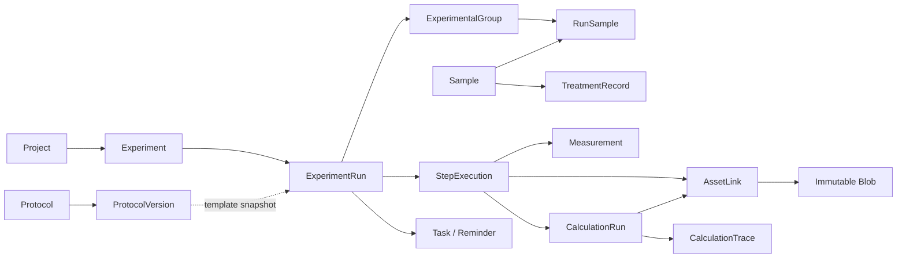

# 02｜领域模型、Protocol、执行引擎和时间管理

## 2.1 实体与关系

**Project** → Experiment（实验概念）→ ExperimentRun（一次真实执行）→ StepExecution（具体步骤执行实例）。一份 ProtocolVersion 可以被无数 Run 引用，运行时克隆参数快照；随时新建 ad hoc StepExecution，后续归纳为 Protocol 草稿。

**Sample** 是可跨 Run 复用的独立对象；可通过 SampleEdge 表示上游/分装/衍生关系；RunSample 分配实验组，TreatmentRecord 记录处理类型、条件、浓度与实际时间。**Measurement** 是输入或仪器测量记录，**CalculationRun** 是由已有数据计算的结果，二者不可混淆；AnalysisRun 记录 AI、图像及统计流程的版本/参数。

## 2.2 领域不变量

1. 所有实体均使用 UUIDv7 或等价唯一 ID；不以 SQLite 自增 ID 进行跨设备引用。
2. 每个写命令携带幂等 ID，业务对象携带 `revision` 用于乐观锁；冲突必须显式提示。
3. Run 已开始时绑定确定 Protocol 版本及运行快照；模板后续编辑不能改变历史 Run。
4. 实验组与实际样本处理记录分离：处理浓度变化生成 TreatmentCorrection，不静默替换已发生操作。
5. 原件和派生文件都属于 Asset；Asset ID 独立于 Blob SHA；多个 Asset 可复用同一个 Blob，删除时遵守引用和垃圾回收。
6. AI 识别值未人工批准前是 DraftMeasurement，不自动成为 confirmed Measurement。
7. 每个确定性衍生科研数值必须可找到完整 CalculationTrace。只有模型建议没有数值运算时应标记 suggestion，不能叫 quantified。
8. 实验计划时间与实际开始/结束时间分开保存；到期通知不等于实验实际完成。
9. 软删除、数据纠正、跨端合并必须追加事件；永久清理是显式危险动作，保留墓碑与删除原因。

## 2.3 Protocol DSL 设计

正式定义见 `contracts/protocol-v2.schema.json`。顶层：`schema_version`, `protocol_id`, `version`, `status=draft/approved`, `title`, `variables`, `steps`, `sources`, `warnings`。

`Step` 类型枚举：action（操作）、wait（等待）、measure（测量）、calculate（计算包）、image（原始成像与多模态工具）、record（记录）、decision（分支）、repeat（有界重复）、sample（样本分装/关联）、review（人工确认）。

每步支持：

- `step_id`, `kind`, `title`, `instructions`, `depends_on`, `step_parameters`；
- `duration.expected_seconds`、`min/max_seconds`、`origin=user|sop|historical|ai_estimate|unknown`；
- `captures[]`（类型、单位、关联样本、是否必填）；
- `tool_ref`（CalculationPack ID + 版本），`output_bindings`（绑定上游计算结果）；
- `notification_rule`、`human_gate`、`source_evidence`（资产 SHA + 原文引用）；
- `repeat` 须包含最大次数；`decision` 须包含可验证条件或人工分支。

**时长不能编造**：来源不明时 `expected_seconds=null`，允许暂不排计划；AI 建议的估计必须在 UI 中显式标识，待用户确认。对于含多个并行步骤的 Protocol 使用 DAG 和资源冲突信息计算时间轴。

## 2.4 Protocol 创建的五种方式

1. 立即开始实验，不填写模板，按需添加通用节点。
2. 上传 PDF/DOCX/Markdown/图片 SOP → 多模态 AI 提取 → 生成为待审 Protocol Pack。
3. 输入自然语言“我需要按实验组做 BCA 测定后接 WB” → AI 组合现有步骤和计算 Pack。
4. 从历史 ExperimentRun 生成带来源版本的模板。
5. 在 Protocol 编辑器中拖动已有模块、添加变量、修改计时规则。

对图像/扫描 SOP 的解析同样经多模态模型；无需在本地放大型 OCR/CV。文字类型 Word/PDF 可以由轻量文档解析器提取文本及页码；被嵌入的图片仅经用户授权发模型。未经用户同意不将完整 SOP 上传第三方。

## 2.5 Protocol 状态与审核

`draft → validating → review_required → approved → archived`。AI 只能创建/修改草稿，不能绕过用户审核。校验包括 schema、重复 step_id、循环依赖、未知变量、单位不兼容、运行时不支持的算子和缺失的受试实验条件。正式运行使用 approved 快照。对于某次临时实验允许 `ad_hoc`，但同样保存每步事件和参数。

## 2.6 步骤状态机与计划/实际记录

- Run：draft→planned→running↔paused→completed/failed/cancelled。
- Step：pending→ready→running→waiting/paused→completed；支持 skipped/failed/repeated 与审计纠正。
- 启动步骤：事务更新状态→写 StepEvent→重新计算未开始节点的安排→安排本机提醒。
- 结束等待：计时到期只标记 due，不替代实验执行确认。
- 连续异常（如计时冲突、工作日跨午夜）应在时间轴中提示，不自动覆盖用户原先实验安排。

计算计划时间使用拓扑顺序；`EST(step) = max(计划起始, 前置节点 EFT)`, `EFT=EST+预计时长`，且区分用户主动操作和可并行被动等待。无法确定时长不强制按 0 计算。动态重排程仅作用于未来节点，并以 ScheduleTrace 记录公式与输入。

## 2.7 离线原生提醒

- Windows：原生通知 API/任务调度辅助能力，APP 退出后能否投递取决于选择的实现与系统运行策略，首次验收需覆盖“应用关闭”场景。
- Android：Alarm/Notification，需区分 exact alarm 许可和 Doze 限制。
- iOS：使用本地系统通知；手机系统暂停/杀死应用时不能要求 Python 常驻。APP 恢复时重建未来通知计划。
- 用户可以按步骤设置 `提前 N 分钟`、到期、超时多次提醒；所有提醒有唯一 ID、系统侧投递状态/权限状态，不宣称 100% 秒级送达。

## 2.8 内置 To-Do 与 Microsoft To Do

Step 可派生 Task。内部 Task 为唯一权威，MS To Do 通过可选 OAuth/Microsoft Graph 投影任务；必须保存外部 task_id、list_id、ETag、重试状态，防重复创建。第一阶段单向，后续双向回写仅限“确认任务完成”而不是自动推断实验数据已完成。Webhook 只在 APP 在线或有可运行本地后台代理时发送；无中心服务器不能承诺关机时外部事件立刻发送。
